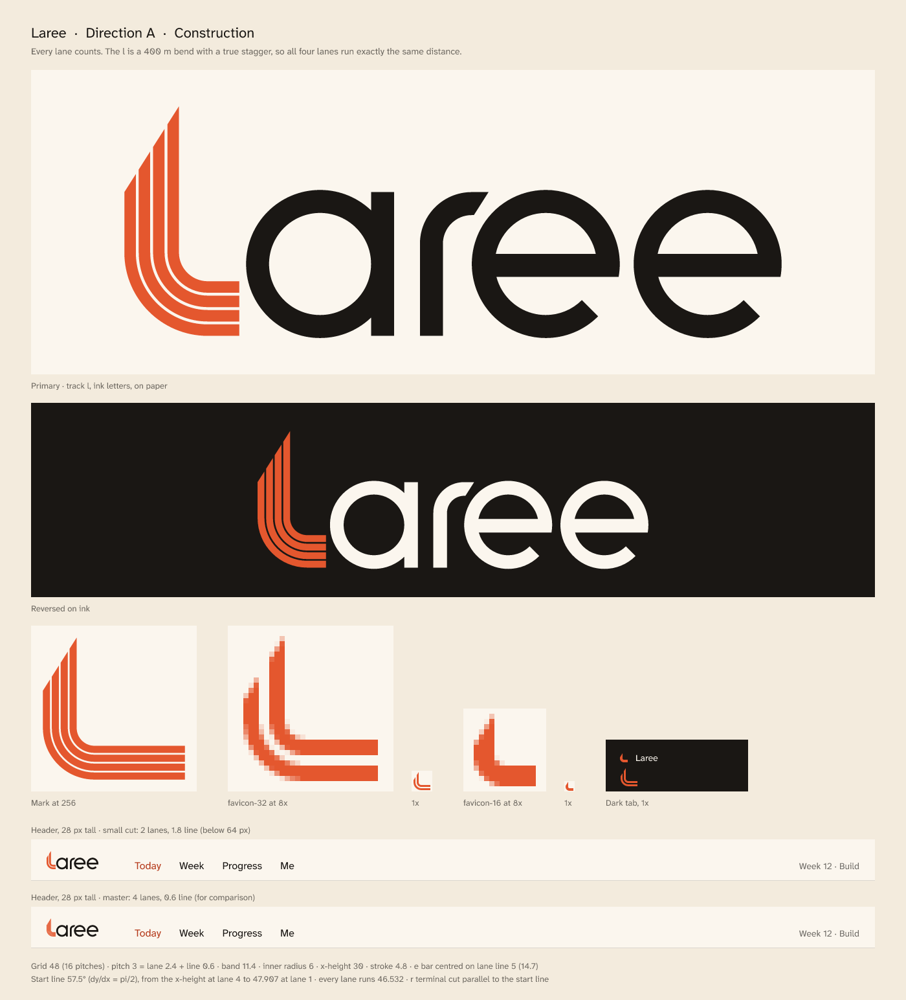
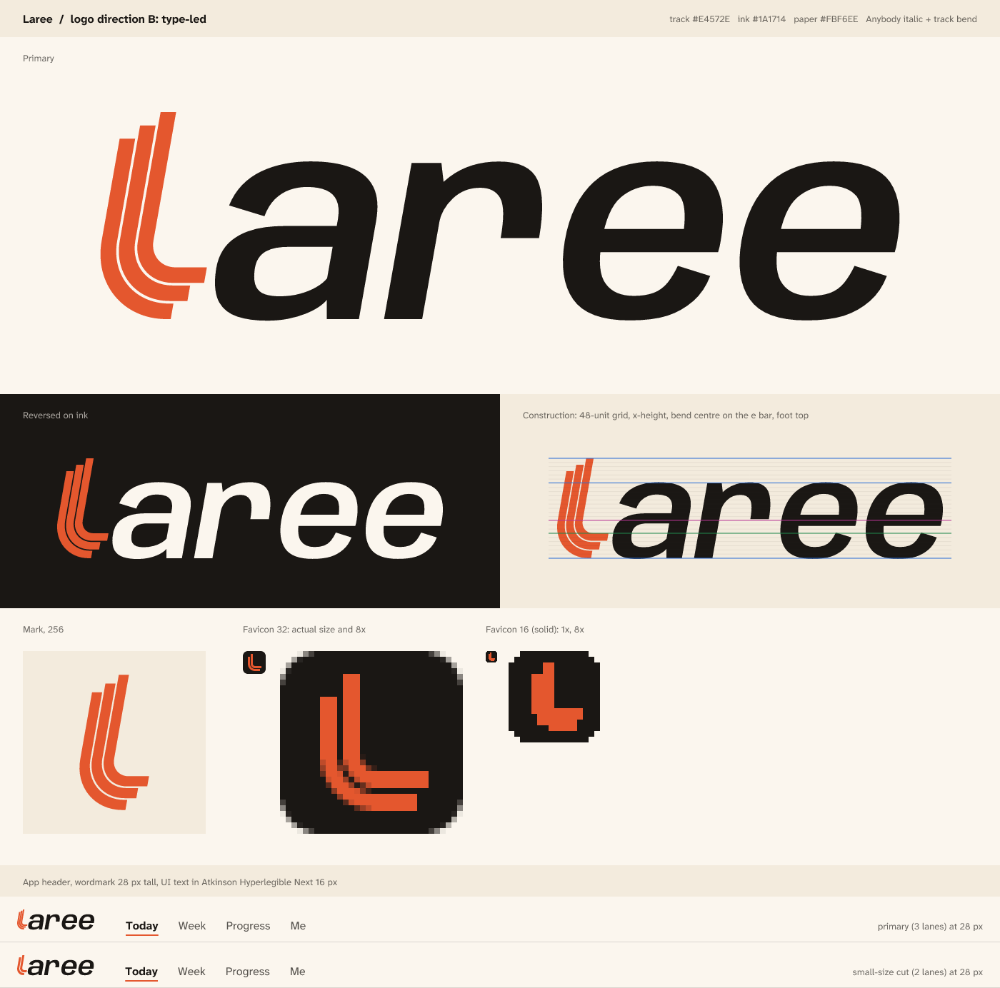
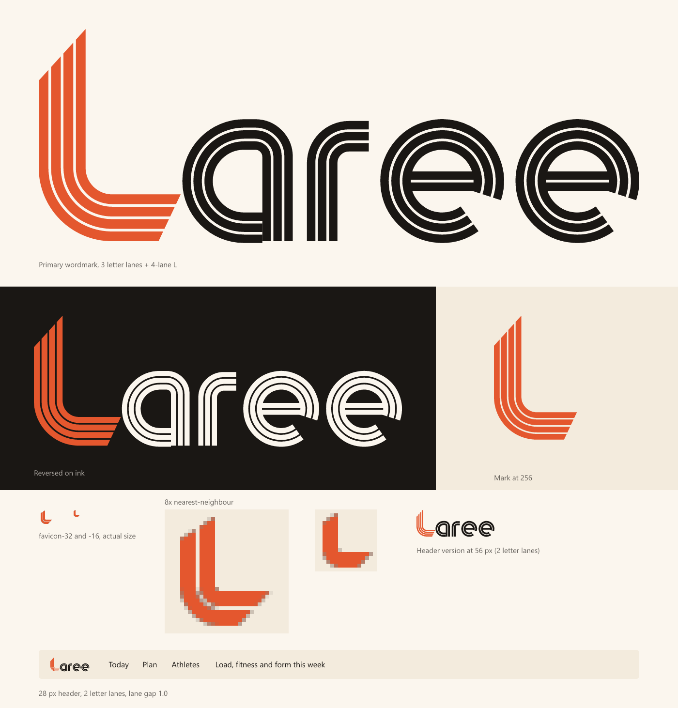

# Logo explorations

Three directions were built from the same brief: a lowercase "laree" whose l is a 400 m track bend, with lanes cut as gaps and a true stagger, so every lane runs the same distance. Three judges scored each direction independently, and the contact sheets below are what they judged. The final logo is in `brand/svg`, its rules are in the [brand guide](../../docs/brand/brand-guide.md), and its numbers are in [Logo construction](../../docs/brand/logo-construction.md).

| Direction | Judge 1 | Judge 2 | Judge 3 | Total |
| --- | --- | --- | --- | --- |
| A, Construction | 36 | 38 | 38 | **112** |
| B, Type-led | 29 | 35 | 36 | 100 |
| C, Lane-built | 32 | 30 | 31 | 93 |

## A, Construction (chosen)

The l is a four-lane bend with all of the stagger at the start, as in a 400 m race. That gives a 57.5° cut across the top of the stem and a square finish line, and every lane measured 46.532 units. The letters "aree" are monoline, 4.8 units thick (exactly two lanes), and are built on the l's lane grid: a single-storey a, an r that bends with the l's inside radius, and two e letters with radial terminals. All three judges scored it highest. Against the other two, it kept the clearest picture of a track, the cleanest small sizes, and the least risk of resembling another sports brand. Its known weaknesses were an l that could read as a capital L, and a thin wedge at the top of the stem at 16 px.

## B, Type-led

The letters are set in Anybody Italic, the app's display face, at width 104 and weight 607. The l is a three-lane bend that leans 10° to match the italic, so the wordmark reads as one word with one special letter. Every lane measured 49.47 units. The judges gave it the best fit with the type system, but the lean read as sportswear and edged towards a swoosh. With three lanes and a slant, the picture of a 400 m track was lost.

## C, Lane-built

The whole word is one track. The l has four lanes, and every letter is built from three lanes 1.9 units wide, so the a, the r and the e letters all carry lane lines. The stagger is split 70/30 between the start and the finish, and every lane measured 56.343 units. The judges found it the most distinctive of the three, but busy. It was weak at small sizes and looked like the 1970s, and with every letter striped, the l stopped being the hero.

## Why the final is A

A won on every judge's card, so the final keeps its structure: four lanes, monoline letters on the l's grid, and the l as the only striped shape. Ideas from the judges and the other directions were added only where they made it better.

Taken:

- **The 70/30 stagger split, from C.** Two judges asked for it. The finish now leans 25.2° along the side of the a instead of stopping square, and the start cut drops to 47.7°. Every lane now runs 46.625 units.
- **A stroke of 5.4 instead of 4.8.** This is two lanes plus the line between them, and it makes the r's outside radius equal to the l's band (11.4).
- **The e crossbar's top edge on the line through the bend centre**, 17.4 above the baseline, with the bar at 4.8 as an optical correction.
- **New spacing**: 2.4 from the foot to the a, 4.5 from a to r, 2.7 from r to e and 3.0 between the two e letters.
- **The favicons from B**: an upright, pixel-snapped two-lane L on an ink tile, now drawn at 16, 32 and 48 px.
- **A three-lane cut for app icons**, from a judge's note.
- **Paths with no transforms**, also from a judge's note.

Not taken:

- **A lane line through the r, from C.** It read as a stencil glitch and vanished below 64 px.
- **A two-lane e crossbar.** It turned the e into a euro sign.
- **An overshoot of 0.3.** The final keeps 0.45.
