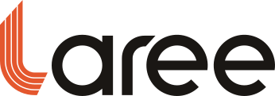
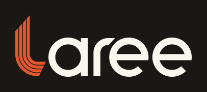
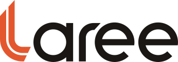
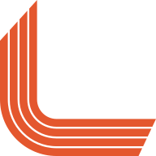
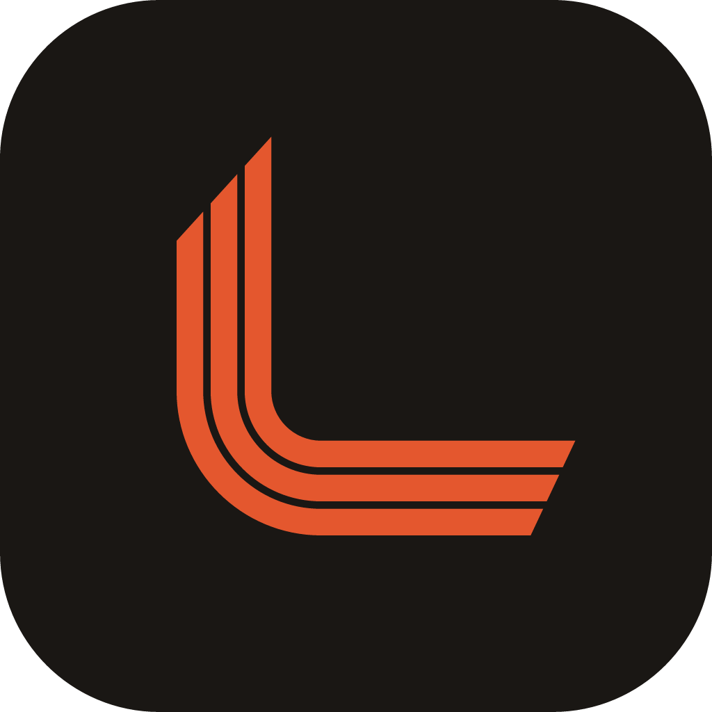
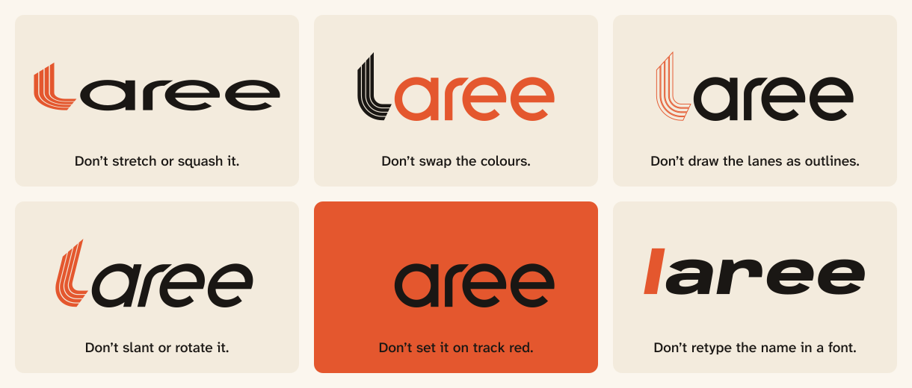

# Laree brand guide

This guide covers the Laree logo, the colours and type that sit around it, and the way Laree talks. It is for anyone who designs, builds or writes for the product. The product rules behind it are in [PRODUCT.md](../../PRODUCT.md), and the interface system is in [DESIGN.md](../../DESIGN.md). Every measurement of the logo is in [Logo construction](logo-construction.md).

The logo is generated, not drawn by hand. Its shapes come from one file, `brand/src/logo-geometry.ts`, and `npm run brand` rebuilds every SVG, PNG and icon in the repository from it. Do not edit the exported files. Change the geometry, run the build, then run `npx vitest run brand` to check the tests.

## The story

Laree, said la-REE, is a coined spelling of the Malay word *lari*, which means "run". The spelling keeps the sound and gives the name a shape of its own.

The "l" is one corner of a 400 m running track. Its stem is the straight, the bend sits on the baseline, and the foot runs along the baseline into the rest of the word. Four lanes run side by side. The lane lines between them are gaps in the red, never drawn lines.

The lanes carry the idea. On a real track the outer lanes start further ahead, because their bend is longer. In a one-lap race, lane 8 starts about 53 m ahead of lane 1, and every runner still covers exactly 400 m. The l does the same. Its start line across the top of the stem and its finish line at the end of the foot are cut at an angle, so each outer lane starts lower and finishes sooner. Measured along its centre line, every lane in the logo is 46.625 units long. No lane is shorter than another.

That is what Laree is for. One coach plans for several athletes, with different sports, levels and lives, and every plan is held to the same honest numbers. **Every lane counts.**

## The logo



The wordmark is the lowercase word "laree". The l is track red and the letters "aree" are ink. The letters are drawn on the same grid as the l: their stroke is exactly two lanes and the line between them, the r bends with the l's inside radius, and the crossbars of both e letters sit on the line through the centre of the l's bend.

### Variants

| Variant | Files | When to use it |
| --- | --- | --- |
| Wordmark | `brand/svg/laree-wordmark.svg`, `brand/png/laree-wordmark@1x.png`, `@2x`, `@4x` | The default, on paper and other light surfaces. |
| Wordmark on paper | `brand/svg/laree-wordmark-on-paper.svg` | When the background is unknown. The paper background includes the clear space. |
| Wordmark, reversed | `brand/svg/laree-wordmark-reversed.svg` | On ink, on the night theme and on dark photographs. The l stays track red and the letters turn paper. |
| Wordmark, one colour | `brand/svg/laree-wordmark-mono-ink.svg`, `brand/svg/laree-wordmark-mono-paper.svg` | One-colour print, foil, engraving, and anywhere red is not available. |
| Wordmark, small | `brand/svg/laree-wordmark-small.svg` | Heights under 64 px. Two wider lanes instead of four. |
| Wordmark, solid | `brand/svg/laree-wordmark-solid.svg` | Embroidery, debossing and rubber stamps, where narrow gaps fill in. |
| Mark | `brand/svg/laree-mark.svg`, `brand/svg/laree-mark-mono.svg`, `brand/svg/laree-mark-solid.svg`, `brand/png/laree-mark-512.png`, `brand/png/laree-mark-1024.png` | The l on its own, when the name is already on screen or the space is square. |
| App icons | `brand/svg/laree-app-icon.svg`, `brand/svg/laree-app-icon-maskable.svg`, `brand/svg/laree-icon-monochrome.svg`, `brand/png/laree-app-icon-1024.png` | Home screens, app stores and Android adaptive and themed icons. |
| Favicons | `brand/svg/favicon-16.svg`, `brand/svg/favicon-32.svg`, `brand/svg/favicon-48.svg`, `public/favicon.ico`, `public/favicon.svg` | Browser tabs and bookmarks. |
| Social image | `brand/svg/og-image.svg`, `public/og.png` | Link previews. |

<p>
  
  
  
</p>

<p>
  
  
  
  
  
</p>

The one-colour paper file is paper on a transparent background, so it disappears on this page. Use it on ink, on dark photographs, and for white foil or white ink.

### Lane cuts

At full size the l has four lanes. As it gets smaller the lane lines become thinner than a pixel and blur, so the logo switches to a cut with fewer, wider lanes. Every cut keeps the band the same width (11.4 units) and keeps the same amount of red (9.6 units). The white of the three full-size lane lines (1.8 units in total) is shared between fewer, wider lines. In every cut, every lane is still 46.625 units long.

| Cut | Lane | Lane line | Where it is used |
| --- | --- | --- | --- |
| Four lanes | 2.4 | 0.6 | The wordmark at 64 px tall or more. The mark at 128 px or more. |
| Three lanes | 3.2 | 0.9 | The mark from 48 to 127 px. App icons. |
| Two lanes | 4.8 | 1.8 | The wordmark under 64 px tall. The mark under 48 px. |
| One lane | 11.4 | none | Embroidery, debossing and stamps. |

The `Logo` component picks the cut from its `size`. For exported artwork, choose the file by the size it will appear at.

## Clear space

Leave 12 units clear on every side of the wordmark and of the mark. That is the band plus one lane line (11.4 + 0.6), or four lane pitches, or a quarter of the logo's height. On a wordmark 48 px tall the clear space is 12 px; on one 96 px tall it is 24 px.

Nothing goes inside the clear space: no text, no edges, no other logos and no busy parts of a photograph. The on-paper and reversed files have the clear space built into their backgrounds, so they can be placed edge to edge with other content.

When Laree appears with a partner or an event, put the two logos side by side at the same visual height, separated by the clear space and a hairline. Never merge them, and never recolour the Laree logo to match.

## Minimum sizes

On screen:

- The four-lane wordmark needs at least 64 px of height (about 183 px of width).
- Below that, use the two-lane wordmark, down to 24 px tall (about 69 px wide).
- The mark keeps four lanes from 128 px, three lanes from 48 px and two lanes down to 24 px.
- Below 24 px, use the favicon drawings, which are made for whole pixels at 16, 32 and 48 px.

In print, the thinnest lane line must be at least 0.15 mm wide, or it fills in. That gives these minimum widths:

- the four-lane wordmark: 35 mm
- the two-lane wordmark: 20 mm, a limit set by the letters rather than the lines
- the four-lane mark: 12 mm
- the two-lane mark: 6 mm

Below those sizes, and for any process that cannot hold a fine gap, use the solid one-lane cut.

## Colour

| Colour | Hex | Role |
| --- | --- | --- |
| Track | `#E4572E` | The l. Large type and graphics. Button fills, always with ink labels. |
| Track ink | `#B5391A` | Red text and links on paper. |
| Sun | `#FFC83D` | Highlights and celebrations, always paired with ink. |
| Ink | `#1A1714` | Text, the letters of the wordmark, hairlines, and the app icon tile. |
| Paper | `#FBF6EE` | The page. |
| Paper 2 | `#F3EBDD` | Raised and sunken surfaces. |

The night theme uses `#14110E`, `#1E1A16` and `#29241F` for surfaces and chalk `#F2EADC` for text. On the night theme the wordmark's letters turn chalk and the l stays track red.

The rules:

- **The l is always track red**, or the same single colour as the letters in one-colour work. It is never ink beside red letters, and it is never another colour.
- **Red never signals status.** Track red is the brand, not an alarm. Missed sessions, sessions over plan and errors each have their own colour, a shape and a word, as set out in [DESIGN.md](../../DESIGN.md). Oxblood is reserved for destructive controls, and it always comes with a glyph and a word.
- **Colour is never the only signal.** Anything that matters also has a word, a shape or a number.
- **Mind the contrast.** Track on paper is 3.4:1. That is enough for the logo, display type and graphics, but not for body text, so red text uses track ink (5.5:1 on paper). Paper text on track is also 3.4:1, so buttons put ink labels on a track fill (4.9:1). Sun on paper is only 1.4:1, so sun is a fill with ink on it or beside it (11.5:1), never a text colour or a thin line.
- **No effects.** The brand has no gradients, drop shadows, glows, bevels or 3D. It also has no purple: the single violet in the interface marks "Over" hatching and never appears in brand artwork.

## Typography

**The logo is drawn, never typed.** No font contains these letters, and typing "laree" in a font, even the brand font, does not make the logo.

**Display type is Anybody**, a variable font with a width axis from 50 to 150 and a weight axis from 100 to 900. The width axis switches between the two registers of the product:

- **Athlete screens** ("race day") set Anybody wide, heavy and italic, at width 125 and weight 800, like the number on a race bib. The tagline on the social image uses this setting.
- **Coach screens** ("results sheet") set it narrow and upright, at width 75 and weight 600, like the type on a results sheet pinned up after a meet.

One family runs both registers, so the two halves of the product look related while feeling different. Set the axes with `font-variation-settings` and `font-stretch`, and turn off `font-synthesis` so the browser never fakes a bold or an italic.

**Text is Atkinson Hyperlegible Next**, designed so that similar letters and figures stay distinct, which matters when a number is read at a glance mid-session. **Numbers in tables, splits and times use Atkinson Hyperlegible Mono**, so columns line up. Athlete screens start from a 17 px base size and coach screens from 14 px. All three families are self-hosted from `@fontsource-variable`.

The product does not use Inter, Geist, Space Grotesk, DM Sans, Manrope, Poppins or Bricolage Grotesque. They are the default look of current software, and Laree should not look like a template.

## Voice and tone

Laree speaks plain English. Sentences are short, numbers are concrete, and spelling is British. There are no hype words and no emoji. Every metric is explained in words where it first appears. When we write about a real person whose pronouns we do not know, we use they and them.

There are two registers, matching the two halves of the product.

**Athletes** get warmth and directness: one idea per line, in the second person. Celebrate what was done. Never use guilt.

| Do | Don't |
| --- | --- |
| Rest day. It's part of the plan, and it counts towards your streak. | No workout today. Stay hungry! |
| 45 min easy run. Keep it easy enough to talk the whole way. | Smash a 45-minute recovery run! |
| 4 of 5 sessions done this week. | You failed 1 session this week. |
| 6-week streak. | 42-day streak!!! Don't break the chain! |
| Load 62, about the same as Tuesday's ride. | TSS 62. |
| Two short nights in a row. An early night will do more for your training than any session today. | Warning: poor sleep detected. |

**The coach**, whom the interface calls "Coach", gets terse and exact copy. Numbers come first, labels are short, and every flag shows the rule that raised it.

| Do | Don't |
| --- | --- |
| Resting HR up: 56 bpm this morning, 55 yesterday · baseline 48 · +8 and +7 | Sam may be getting ill! |
| Fitness 54 · Fatigue 71 · Form −17 | CTL 54, ATL 71, TSB −17 |
| Weighted power 212 W · Intensity 0.84 | NP 212, IF 0.84 |
| 2 of 3 athletes on plan this week. | Your squad is on fire! |
| Suggested by AI. Check it before you send it. | AI flagged a problem with Sam. |

The metric names are Load, Fitness, Fatigue, Form, Weighted power and Intensity. Do not use TSS, CTL, ATL, TSB, NP or IF: they are jargon, and some are another company's trademarks.

Two product rules shape the copy as well:

- **Rewards are earned, never gimmicky.** Streaks count weeks, not days, and rest days count towards them. No streak, badge or message rewards doing more than the plan asks.
- **AI is opt-in and off by default.** It never raises a flag; flags come only from published rules. When AI wrote something, say so.

### Writing the name

In running text, write **Laree**: a capital L, then lowercase. Never write LAREE, Lari or Larée. The lowercase "laree" belongs to the logo only. The name is said la-REE.

## Tagline

**Every lane counts.**

This is the tagline, and it is also the idea behind the brand: every athlete matters equally, just as every lane in the logo runs the same distance. The product owner chose it in November 2026.

- It sits under the wordmark on the social image, in store listings and on the sign-in screen. In the prototype it sits under the logo on the role picker.
- Use it wherever the logo is explained, such as the about page, the coach's onboarding or a slide in a talk.
- Write it in sentence case, with its full stop. In artwork it is set in Anybody at width 125, weight 800, italic.

"Lap by lap." was the other candidate. It is not a tagline, so never set it under the wordmark.

Never use "Lari lah" or "Jom lari". Apps called "Lari La" and JomRun already exist, and a line like that would read as theirs.

## Misuse



- Don't stretch, squash, slant or rotate the logo.
- Don't swap the colours. The l is red, and the letters are ink, or paper on a dark background.
- Don't draw the lanes as outlines, or the lane lines as strokes. The lane lines are gaps.
- Don't set the logo on track red, where the l disappears, or on a photograph or pattern that fights the lanes.
- Don't retype "laree" in a font, even Anybody.
- Don't change the lane count by hand, straighten the start and finish cuts, or redraw the bend. Use the generated cuts.
- Don't add gradients, drop shadows, glows, bevels, 3D, motion lines or swooshes.
- Don't put a running figure, a lightning bolt or a tick beside the logo. The l is the only symbol.
- Don't let any artwork drift towards another sports brand. Avoid the look of Nike, Strava, Garmin, TrainingPeaks or Zwift.
- Don't use the l or track red to mean "wrong", "late" or "missed".

## App icon, favicon and social image

**App icon.** The app icon is the three-lane mark in track red on an ink tile. Four lanes blur on a home screen, so the icon uses three. The mark fills 56% of the tile, and the tile's corner radius is 22.37% of its size. The mark sits 2.4 units up and to the right of centre, because the weight of the l sits low and to the left and a box-centred mark looks low. The tile is ink, not red, because red on ink keeps 4.9:1 contrast, while a paper l on a red tile would be the white-on-track pairing the system avoids.

**Maskable icon.** The maskable icon is full-bleed ink with the mark at 50%. Android crops it to a circle, a squircle or a rounded square. The whole mark stays inside the central safe circle: its farthest point is 321.5 px from the centre of the 1024 px icon, and the safe radius is 409.6 px.

**Monochrome icon.** The monochrome icon is the mark alone, for Android themed icons, where the system supplies the colour.

**Favicons.** At 16, 32 and 48 px a four-lane bend cannot be drawn honestly, so the favicons are separate drawings in whole pixels. Each is an upright two-lane L on an ink tile, with lane widths chosen so that every straight edge lands on a pixel. The bend is tightened so the L reads as a letter rather than a hook. The stagger survives at this size: in each favicon, both lanes run the same distance. `public/favicon.ico` holds the 16, 32 and 48 px drawings, and `public/favicon.svg` is the 32 px drawing.

**Social image.** The social image (`public/og.png`, 1200 × 630) puts the wordmark and "Every lane counts." on paper, with a large four-lane bend wrapping the lower right corner.

Add these lines to the `<head>` of `index.html`. The build uses `base: './'`, so the paths are relative. Open Graph needs an absolute URL, so replace the placeholder with the deployed address.

```html
<link rel="icon" href="./favicon.ico" sizes="32x32" />
<link rel="icon" href="./favicon.svg" type="image/svg+xml" />
<link rel="apple-touch-icon" href="./apple-touch-icon.png" />
<link rel="manifest" href="./manifest.webmanifest" />
<meta name="theme-color" content="#FBF6EE" media="(prefers-color-scheme: light)" />
<meta name="theme-color" content="#14110E" media="(prefers-color-scheme: dark)" />
<meta property="og:image" content="https://DEPLOYED-ADDRESS/og.png" />
<meta property="og:image:alt" content="The Laree wordmark and the tagline Every lane counts." />
```

The web app manifest lists the icons like this:

```json
"icons": [
  { "src": "pwa-192.png", "sizes": "192x192", "type": "image/png" },
  { "src": "pwa-512.png", "sizes": "512x512", "type": "image/png" },
  { "src": "pwa-maskable-512.png", "sizes": "512x512", "type": "image/png", "purpose": "maskable" },
  { "src": "pwa-monochrome-512.png", "sizes": "512x512", "type": "image/png", "purpose": "monochrome" }
]
```

`apple-touch-icon.png` (180 px) is the app icon on a solid ink square, because iOS applies its own mask and fills transparent corners with black.

## The logo in the app

Use the `Logo` component from `src/ui/brand/Logo.tsx`. It draws from the same geometry as the exported files, so it never goes out of date.

```tsx
<Logo title="Laree" />                     // the wordmark, 32 px tall
<Logo variant="mark" size={40} title="Laree" />
<Logo tone="reversed" />                   // paper letters, for a fixed ink background
<Logo tone="mono" />                       // everything in currentColor
```

- `size` is the rendered height in CSS pixels. The width follows the artwork, and the lane cut follows the size.
- In the primary tone, the l uses `--palette-track` and the letters use `--color-text`. The same logo is ink on paper and chalk on the night theme, with no second variant to manage.
- Give the logo a `title` when it is the only name for something, such as a home link with no text. Leave the title out when the logo is decorative; the component then hides it from assistive technology.

## Files and rebuilding

| Path | What it holds |
| --- | --- |
| `brand/src/logo-geometry.ts` | The geometry: every number, every cut, the icons and the favicons. |
| `brand/src/logo-geometry.test.ts` | Tests: equal lanes in every cut, path structure, layout, size rules, whole-pixel favicons and the maskable safe circle. |
| `scripts/brand/build-logo.ts` | Writes `brand/svg/*` and `public/favicon.svg`. |
| `scripts/brand/rasterize.ts` | Writes `brand/png/*`, the PWA and touch icons, `public/og.png` and `public/favicon.ico`. |
| `scripts/brand/font-outline.ts` | Turns text in brand artwork into outlines, so no exported file needs a web font. |
| `scripts/brand/make-ico.ts` | Packs PNGs into a `.ico` file. |
| `src/ui/brand/Logo.tsx` | The logo in the app. |
| `brand/explorations/` | The three directions explored before this one, and why this one won. |

Run `npm run brand` after any change to the geometry, then commit the regenerated files with it.
