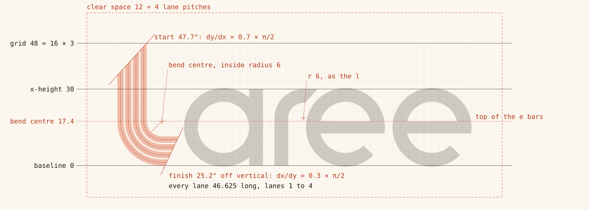

# Logo construction

This is how the Laree logo is built, with every number taken from `brand/src/logo-geometry.ts`. The values live in `PARAMS` in that file, and `brand/src/logo-geometry.test.ts` checks the rules described here. To change the logo, change those numbers, run `npm run brand`, and run `npx vitest run brand`. Do not edit the exported SVGs. For how the logo is used, see the [brand guide](brand-guide.md).

## Units and grid

The logo is drawn in units on a 48-unit grid.

- The l is 48 units tall, from the baseline to the top of its start line.
- The x-height is 30 units.
- Round letters overshoot the x-height and the baseline by 0.45 units.
- The wordmark's viewBox fits the artwork tightly: 138.586 × 48.45 units. The extra 0.45 is the overshoot below the baseline. Clear space, 12 units on every side, is added outside the viewBox.

The geometry is worked out with y pointing up from the baseline, then written out as SVG with y pointing down, so the baseline sits at SVG y = 48. In the tables below, "above the baseline" means the y-up value.

## The lanes

| Measure | Units |
| --- | --- |
| Lane width | 2.4 |
| Lane line (a gap, never a stroke) | 0.6 |
| Pitch (lane + line) | 3.0 |
| Lanes | 4 |
| Band (4 lanes + 3 lines) | 11.4 |
| Inside radius of lane 1 | 6 |
| Bend centre | 17.4 in from the outer edge of the stem, 17.4 above the baseline |

Lane 1 is the inner lane: it forms the right edge of the stem and the top edge of the foot. Each lane is its own closed shape, made of a straight, a quarter circle and a straight. The lane lines are the gaps between the shapes.

| Lane | Inside radius | Centre radius | Outside radius |
| --- | --- | --- | --- |
| 1 | 6 | 7.2 | 8.4 |
| 2 | 9 | 10.2 | 11.4 |
| 3 | 12 | 13.2 | 14.4 |
| 4 | 15 | 16.2 | 17.4 |

## The stagger

Every lane runs the same distance, as on a real track. Here is why the cut lines guarantee it.

Take any line through the band, parallel to the lanes, at a distance *o* from the inside edge of lane 1. A lane's centre line is one such line, and so is each of its edges. That line runs up the stem to the start line, round a quarter circle of radius *r0 + o*, and along the foot to the finish line.

- The start line drops by *kS* units for every unit across the band, so the stem straight loses *kS·o*.
- The finish line pulls back by *kF* units for every unit across, so the foot straight loses *kF·o*.
- The quarter circle gains *(π/2)·o*.

So the length is:

> L(o) = (tip − cy) − kS·o + (π/2)·(r0 + o) + (finish − cx) − kF·o

This is the same for every *o* exactly when *kS + kF = π/2*. The l splits the π/2 between the two ends, 70% at the start and 30% at the finish:

| | Value |
| --- | --- |
| Start slope *kS* = 0.7 × π/2 | 1.0996 (dy/dx), 47.7° from horizontal |
| Finish slope *kF* = 0.3 × π/2 | 0.4712 (dx/dy), 25.2° from vertical |
| Where the start line meets lane 1's inside edge (*tip*) | 48 above the baseline |
| Where the finish line meets lane 1's inside edge (*finish*) | x = 24 |
| Bend centre (*cx*, *cy*) | 17.4, 17.4 |
| Lane length, every lane | (48 − 17.4) + (24 − 17.4) + (π/2) × 6 = 30.6 + 6.6 + 9.425 = **46.625** |

Across the 11.4-unit band, the start line drops 12.535 units, so the outer lane starts 12.535 units below the inner one. The finish line pulls back 5.372 units, so the outer lane finishes at x = 18.628 against the inner lane's 24.

The split does not change the lengths, only where the stagger shows. A 50/50 split cuts both ends at 38.1°. The 70/30 split gives a steep, obvious staggered start at the top of the stem and a gentler finish that leans along the side of the a, so the foot hands over to the letters with an even gap.

The mark is the same l with the foot run on to x = 48, so the bend sits in a 48-unit square. Every lane of the mark is (48 − 17.4) + (48 − 17.4) + 9.425 = **70.625** units long.

## The letters

The letters are monoline and share the l's grid. The stroke is **5.4 units**: exactly two lanes and the line between them (2.4 + 0.6 + 2.4).

**a.** A single-storey a. Its ring has an outer radius of 15.45 (half the x-height plus both overshoots) and an inner radius of 10.05, centred 15 above the baseline. A 5.4-wide stem sits flush with the right of the ring and runs from the baseline to the x-height. Width: 30.9.

**r.** A 5.4-wide stem and a quarter bend with the l's inside radius of 6, which makes its outside radius 11.4, the width of the l's band. The bend centre is 11.4 to the right of the stem's left edge and 18.6 above the baseline. The underside of the arm runs 0.6 past the bend centre. The terminal is then cut parallel to the l's start line, at 47.7°, so the top of the arm runs 5.511 past the bend centre. Width: 16.911.

**e.** The a's ring, opened on the lower right. The crossbar is 4.8 thick. Its top edge sits on the line through the l's bend centre, 17.4 above the baseline, so the bar runs from 12.6 to 17.4 and the eye above it is 7.65 tall. The terminal is a radial cut at −45°, below the centre on the right. The opening runs from that cut up to the underside of the bar.

## Spacing

The gaps are measured as the closest distance between neighbouring shapes. The a and the first e are placed by solving for the circle that exactly clears the cut beside it (`clearCircle`), so these gaps are exact, not judged by eye.

| Pair | Gap | Note |
| --- | --- | --- |
| Finish line to the a | 2.4 | One lane. |
| a to r | 4.5 | Stem to stem. |
| r terminal to e | 2.7 | |
| e to e | 3.0 | One pitch. |

| Letter | Left edge | Right edge |
| --- | --- | --- |
| a | 26.033 | 56.933 |
| r | 61.433 | 78.344 |
| e | 73.786 | 104.686 |
| e | 107.686 | 138.586 |

The r's arm overhangs the left edge of the first e (78.344 against 73.786), as a kerned pair would. The terminal's slant keeps the 2.7 gap.

## Optical corrections

- **Overshoot of 0.45**, 1.5% of the x-height. One judge suggested about 0.3. The final keeps 0.45 because it sits in the middle of the usual range for geometric letters, and because the round a and e stand beside the flat top of the r and the flat ends of the l, where any shortfall in height shows.
- **Crossbar of 4.8 against a stroke of 5.4.** Horizontals look heavier than verticals of the same width, so the e bar is thinner.
- **Icon shift of 2.4 units.** The l's weight sits low and to the left, so a mark centred on its box looks low. Icons move it up and to the right by one lane.
- **Tightened favicon bends.** At 16 to 48 px the true radius reads as a hook, so the favicons use an inside radius of 1 to 3 px.

## Lane cuts

Every cut keeps the band at 11.4 units and the red at 9.6 units (four lanes of 2.4). The white of the three master lane lines (1.8 units) is shared between the lines that remain.

| Cut | Lane | Line | Paint | White |
| --- | --- | --- | --- | --- |
| 4 lanes | 2.4 | 0.6 | 9.6 | 1.8 |
| 3 lanes | 3.2 | 0.9 | 9.6 | 1.8 |
| 2 lanes | 4.8 | 1.8 | 9.6 | 1.8 |
| 1 lane | 11.4 | none | 11.4 | 0 |

Because every cut keeps the same tip, finish and inside radius, every lane in every cut is still 46.625 units long, and 70.625 in the mark. The tests check this for all four cuts, for the wordmark and the mark, and for any split from 0 to 1.

`lanesForSize` picks the cut from the rendered height:

| Variant | 4 lanes | 3 lanes | 2 lanes |
| --- | --- | --- | --- |
| Wordmark | 64 px tall and up | not used | under 64 px |
| Mark | 128 px and up | 48 to 127 px | under 48 px |

At 63 px tall, the master lane line on the wordmark would be 0.78 px and would blur, which is why the switch happens at 64 px. The two-lane line at 24 px is still 0.9 px wide.

## Icons

Icons use the mark in three lanes, placed with no transforms: every point is scaled into pixel space.

| | App icon | Maskable icon |
| --- | --- | --- |
| Size | 1024 px | 1024 px |
| Mark size | 56% (573.44 px) | 50% (512 px) |
| Pixels per unit | 11.947 | 10.667 |
| Tile corner radius | 22.37% (229.1 px) | none, full bleed |
| Optical shift (2.4 units up and right) | 28.67 px | 25.6 px |
| Mark origin (top left of the 48-unit square) | 253.952, 196.608 | 281.6, 230.4 |
| Lanes | 3 | 3 |

On the maskable icon, the farthest point of the mark is the outer corner of the finish, 321.5 px (30.15 units) from the centre. The safe circle's radius is 40% of the icon, 409.6 px, so the mark clears it by 88 px. A test checks every point.

## Favicons

The favicons are separate drawings in whole pixels: an upright two-lane L on an ink tile. Every straight edge sits on a whole pixel, and only the start and finish cuts are diagonal. They keep the 70/30 split, and both lanes run the same distance.

| Size | Tile radius | Stem edge x | Baseline row | Tip | Finish x | Lane | Line | Inside radius | Lane length |
| --- | --- | --- | --- | --- | --- | --- | --- | --- | --- |
| 48 | 10.5 | 7 | 41 | 6 | 42 | 5 | 2 | 3 | 44.712 |
| 32 | 7 | 5 | 27 | 4 | 28 | 3 | 2 | 2 | 29.142 |
| 16 | 3.5 | 2 | 14 | 1 | 14 | 2 | 1 | 1 | 14.571 |

All measurements are in pixels, in SVG space.

## The social image

The 1200 × 630 image uses the logo's own track function at pixel scale. The bend has four lanes of 20 px with 5 px lines (the master's 4:1 ratio) and an inside radius of 70 px. Its outer edge is 56 px from the right and bottom edges. It is mirrored, so the lanes come in along the bottom from a staggered start at x = 96 and leave off the top edge on a common line. With the top out of frame, all of the stagger goes to the visible end (split 0), and every lane still runs the same distance.

The wordmark sits at 4.2 px per unit, with its top left at (96, 92). The tagline "Lap by lap." is set in Anybody at width 125, weight 800, italic, 64 px, with its baseline 116 px below the wordmark's baseline. It is converted to outlines.

## Path rules

- Paths use only absolute M, L, A and Z commands, with no transforms. Numbers are rounded to three decimals and never print as −0.
- Each lane is one closed subpath with two quarter arcs. Fills use the nonzero rule: solid shapes wind clockwise and holes (the a's counter, the e's eye) wind anticlockwise.
- The four-lane wordmark is about 1.2 KB of SVG, small enough to inline.
- Any text in exported artwork is converted to outlines by `scripts/brand/font-outline.ts`, so no file depends on a web font.

## Ideas tried and rejected

- **A lane line through the r**, from direction C. It echoes the l, but it reads as a stencil glitch and vanishes below 64 px. `PARAMS.rLanes` stays at 1.
- **A two-lane e crossbar.** It turns the e into a euro sign.

The three directions explored before this one, and their scores, are in [brand/explorations](../../brand/explorations/README.md).

## Tests

`brand/src/logo-geometry.test.ts` checks that:

- every lane has the same length, in every cut of the wordmark and the mark, in the favicons, and for any split
- the l refuses a stagger that would use up a straight
- every number in every path is finite
- the l has one closed subpath per lane, with two quarter arcs each
- the letters have the expected subpaths, and paths use only M, L, A and Z
- the wordmark sits in a tight viewBox with the baseline at 48
- the letters run left to right with the right gaps
- the mark fills its 48-unit square
- the e crossbars sit on the bend-centre line
- the start line's angle matches the split
- each cut keeps the band, the paint and the white
- the lane cut switches at the right sizes
- favicon straights sit on whole pixels
- the maskable mark stays inside the safe circle

`src/ui/brand/Logo.test.tsx` checks the component's accessible name, its proportions, its lane cuts and its colours.
