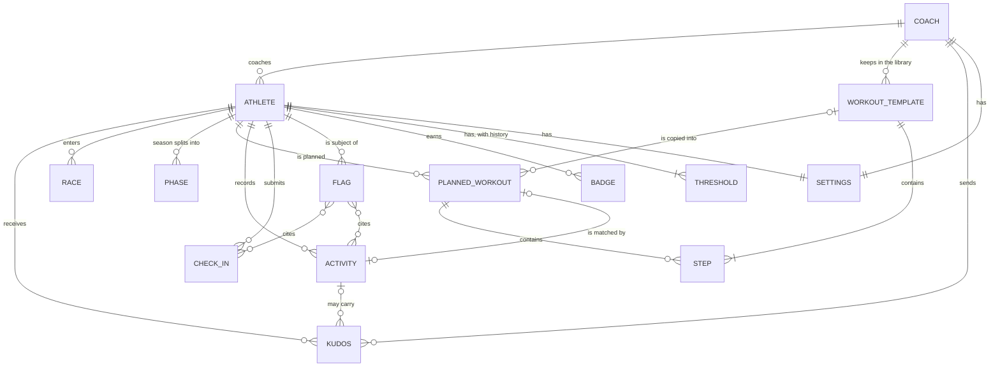

# Information architecture

Laree (said la-REE) is a training planner for triathlon, running and cycling. This document fixes its structure before visual design starts. It says which screens exist, how people move between them, what each screen puts first, which address each screen has, and what the app remembers between visits.

It covers the prototype, which runs on seeded mock data with no backend. The product owner settled the big decisions in four Q&A rounds recorded in the master plan. This document applies those decisions and does not reopen them. Where it had to settle a structural detail the plan left open, the choice is listed in section 14.

| Related document | What it holds |
|---|---|
| `docs/ia/screen-inventory.md` | Every screen, sheet and dialog with its purpose, data, actions, states, responsive and accessibility notes |
| `docs/spec/metrics.md` | Load, Fitness, Fatigue, Form, Ramp and compliance formulas |
| `docs/spec/checkins-flags.md` | Check-in fields, the flag rule table and the flag lifecycle |
| `docs/spec/gamification.md` | Streaks, badges and the track lap |
| `docs/spec/ai.md` | The AI toggle, the two consent layers and the simulated output |
| `docs/spec/io.md` | Import and export formats |
| `DESIGN.md` | Tokens, type, colour, glyphs and motion |

## 1. Ground rules

- **One app, two layouts.** Laree is one installable web app (PWA). The athlete side uses the "race day" register: fun, mobile-first, big type, race-bib cards and very easy navigation. The coach side uses the "results sheet" register: a dense, desktop, keyboard-first instrument. Both share one token set and the "hot track" palette (track red-orange, sunshine yellow, ink, warm off-white).
- **People.** The first trial has one coach and three athletes. In the UI the coach is simply "Coach". The prototype uses three fictional athletes: Amir (70.3 triathlete), Danial (marathoner) and Irfan (gran-fondo cyclist).
- **Locale.** en-MY, weeks start on Monday, time zone Asia/Kuala_Lumpur, metric units (km, m, W, bpm, deg C), British spelling.
- **No accounts.** Everything in the prototype stays on the device. A permanent switcher stands in for sign-in.
- **Base-path agnostic.** The hash router keeps every address inside the fragment (`#/...`). The app works at any base path, including after the repository is renamed.

## 2. Structural answers

The information-architecture method asks five questions before drawing a map. The plan already answers them.

| Question | Athlete | Coach |
|---|---|---|
| What do people do most, in order? | 1. See today's session. 2. Log it. 3. Morning check-in. 4. Look over the week. 5. See progress and badges. | 1. Morning review of the team. 2. Move or edit the next sessions. 3. Read check-ins and clear flags. 4. Send kudos. 5. Build workouts. 6. Plan the season. 7. Read analytics. |
| Where do they spend 80% of their time? | Today. | Overview in the morning. Calendar when planning. |
| How deep can navigation go? | Two levels: a bottom-bar section, then one detail page or sheet. | Two levels: a rail section, then one detail page. Drawers and dialogs open on top of a page and never add a level. |
| What grows over time? | Activities, check-ins, kudos, badges. | The same, plus flags, library workouts and races. Sections are fixed. The athlete list is fixed at three in the trial. |
| Who needs a different entry point? | Athletes start at `#/athlete/today`. | The coach starts at `#/coach/overview`. |

The role picker at `#/` and the prototype switcher choose between the two entry points.

## 3. Site map

Indentation shows nesting. Every item carries its address.

- Role picker `#/`
- Athlete side (athlete shell, bottom bar)
  - `#/athlete` and `#/athlete/` redirect to `#/athlete/today`
  - Today `#/athlete/today`
    - Log sheet `#/athlete/today?sheet=log`
    - Check-in sheet `#/athlete/today?sheet=check-in`
  - Week `#/athlete/week` (`?w=-1` last week, `?w=1` next week)
  - Progress `#/athlete/progress`
  - Me `#/athlete/me`
  - Workout (a planned session) `#/athlete/workout/:workoutId`
  - Activity (a completed session) `#/athlete/activity/:activityId`
- Coach side (coach shell, left rail)
  - `#/coach` redirects to `#/coach/overview`
  - Overview `#/coach/overview`
  - Athlete summary `#/coach/athlete/:athleteId`
  - Calendar `#/coach/calendar/:athleteId?`
  - Season `#/coach/season/:athleteId?`
  - Library `#/coach/library`
    - Workout builder `#/coach/library/:workoutId` (the id `new` creates a workout)
  - Analytics `#/coach/analytics/:athleteId?`
  - Check-ins `#/coach/check-ins` (team check-in grid, flag inbox and kudos)
  - Activity `#/coach/activity/:activityId`
  - Settings `#/coach/settings`
- Brand board `#/brand`
- UI kit gallery `#/kit`
- Reset demo data `#/reset` (asks first)
- Not found (any other address)

### 3.1 Route table

| Route | Screen | Shell | Notes |
|---|---|---|---|
| `#/` | Role picker | Standalone | Start URL of the installed app. |
| `#/brand` | Brand board | Standalone | |
| `#/kit` | UI kit gallery | Standalone | |
| `#/reset` | Reset demo data | Standalone | Asks first. Visiting the address never resets anything on its own. |
| `#/athlete/today` | Today | Athlete | `?sheet=log` opens the log sheet. `?sheet=check-in` opens the check-in sheet. |
| `#/athlete/week` | Week | Athlete | `?w=-1` is last week and `?w=1` is next week. No `w` means this week. |
| `#/athlete/progress` | Progress | Athlete | |
| `#/athlete/me` | Me | Athlete | Profile, thresholds, data in, AI consent, preferences. |
| `#/athlete/workout/:workoutId` | Workout | Athlete | A planned session. |
| `#/athlete/activity/:activityId` | Activity | Athlete | A completed session. |
| `#/coach` | Redirect | Coach | Replaced by `#/coach/overview`. |
| `#/coach/overview` | Overview | Coach | |
| `#/coach/athlete/:athleteId` | Athlete summary | Coach | |
| `#/coach/calendar/:athleteId?` | Calendar | Coach | Without an id it opens the last athlete viewed. |
| `#/coach/season/:athleteId?` | Season | Coach | Same default. |
| `#/coach/analytics/:athleteId?` | Analytics | Coach | Same default. |
| `#/coach/library` | Library | Coach | |
| `#/coach/library/:workoutId` | Workout builder | Coach | `new` creates a workout. |
| `#/coach/check-ins` | Check-ins | Coach | Team grid, flag inbox and kudos. |
| `#/coach/activity/:activityId` | Activity | Coach | |
| `#/coach/settings` | Settings | Coach | |
| Anything else | Not found | Depends on the address | See section 9.6. |

Who is viewing on the athlete side is app state, set by the prototype switcher. It is never part of an athlete URL. In the MVP an athlete only ever sees their own data, so athlete URLs will not need to change when real sign-in arrives.

### 3.2 Week numbering in these docs

The seed and the docs number weeks from the runtime start, which is the Monday 16 weeks before the current week. History weeks are 1 to 16. The current week is week 17, also called week 0 when counting ahead, and week +n is n weeks after it. The seed holds 16 weeks of history and 12 weeks of plan. The history follows three weeks up and one week down at about 85% compliance.

These numbers never appear in the UI. Athletes see "This week", "Next week", "Last week", "In 3 weeks" or "3 weeks ago" next to the date range. The coach sees date ranges and "weeks to race".

## 4. Navigation model

### 4.1 Prototype switcher (every route)

A slim bar sits at the very top of every route and reads:

**Prototype - viewing as** [Coach | Amir | Danial | Irfan]

- It is a single-choice control with four options. The current option is always visible. It never covers content: both shells and the standalone frame start below it.
- A small "Prototype" menu at its end holds Role picker, Brand board, UI kit and Reset demo data.
- It exists only because the prototype has no sign-in. The MVP drops it. The only other rule that depends on it is "role follows route" (section 9.5).

Choosing an option moves the viewer as follows.

| Where you are | You choose | Where you land |
|---|---|---|
| Anywhere | Coach | The last coach route visited in this session, otherwise `#/coach/overview` |
| A coach route or a standalone page | An athlete | `#/athlete/today`, viewing as that athlete |
| Athlete Today, Week, Progress or Me | Another athlete | The same section, viewing as the new athlete. Week keeps its `?w`. Open sheets close. Drafts stay with the athlete who wrote them. |
| An athlete workout or activity page | Another athlete | `#/athlete/today`, viewing as the new athlete, because the item belongs to someone else |

### 4.2 Athlete: bottom bar

The bottom bar has five slots and shows on every athlete route.

| Slot | Label | Goes to | Notes |
|---|---|---|---|
| 1 | Today | `#/athlete/today` | Home of the athlete side. |
| 2 | Week | `#/athlete/week` | Always opens this week. The week arrows set `?w`. |
| 3 | + Log | `#/athlete/today?sheet=log` | A raised centre action. It opens the log sheet over Today. |
| 4 | Progress | `#/athlete/progress` | |
| 5 | Me | `#/athlete/me` | |

- **Log from anywhere.** Tapping + Log on any athlete screen opens the log sheet on Today. Closing the sheet without saving goes back to where the athlete was. Saving lands on Today, where the week's track lap fills. "Log this session" on a workout page does the same, with that session already chosen as the match. The chosen session travels in app state, not in the URL.
- **Detail pages.** Workout and activity pages keep the bottom bar and add a Back button at the top left. The tab that opened them stays highlighted. On a cold deep link, Week is highlighted, because every session and activity belongs to a week.
- **Gestures are optional.** Swiping between weeks is a shortcut for the week arrows. Sheets can be swiped down, and they also have a Close button. Nothing needs a gesture.

### 4.3 Coach: left rail

The rail is always visible on coach routes at 1024 px and wider. Its order is fixed.

| Rail item | Goes to | Keys | Badge |
|---|---|---|---|
| Overview | `#/coach/overview` | g then o | |
| Athletes: Amir, Danial, Irfan | `#/coach/athlete/:athleteId` | g then 1, 2 or 3 | Flag glyph when that athlete has an open flag. Hollow dot when there is no check-in today. |
| Calendar | `#/coach/calendar` (resolves the athlete) | g then c | |
| Season | `#/coach/season` (resolves the athlete) | g then s | |
| Library | `#/coach/library` | g then l | |
| Analytics | `#/coach/analytics` (resolves the athlete) | g then a | |
| Check-ins | `#/coach/check-ins` | g then i | Count of open flags |
| Settings | `#/coach/settings` | none | |

- **Athlete in context.** Calendar, Season and Analytics show one athlete at a time. The rail links point to the id-less route. The screen resolves the last athlete viewed (Amir on a fresh device) and writes that id into the URL. Each of these screens has an athlete picker in its header (Amir | Danial | Irfan). The `[` and `]` keys step to the previous or next athlete.
- **Last athlete viewed.** Any coach screen whose data belongs to one athlete updates it: the athlete summary, Calendar, Season, Analytics and the coach activity page.
- **Jump to.** A "Jump to" field at the top of the rail (key `/`) finds athletes, sections, library workouts and races.
- **Keyboard help.** A "Keyboard" link in the rail footer opens the same overlay as `?`.

### 4.4 Coach under 1024 px

- The rail collapses into a top bar. It holds the Laree mark, the section name, the athlete picker where the screen has one, and a "Sections" button that opens the rail as a full-height menu.
- Every coach screen becomes a read-only stack. It shows the same data in the same priority order, in one column. Tables turn into stacked rows and charts go full width.
- Editing is off. There is no drag and drop, no builder editing, no phase slider and no form. A banner at the top of the content says: "Planning and editing need a screen at least 1024 px wide. Everything here is read-only."
- Links and detail pages keep working, so the coach can read a flag or an activity on a phone.

### 4.5 Utility navigation

| Need | Where it lives |
|---|---|
| Reset demo data | Prototype menu in the switcher, Me (athlete), Settings (coach) and the role picker. All go to `#/reset`. |
| Brand board and UI kit | Prototype menu and the role picker |
| Units and theme | Me (athlete) and Settings (coach) |
| AI consent | Me (athlete layer) and Settings (coach layer) |
| Keyboard help | `?` on the coach side and the rail footer link |

The athlete side has no help screen. Empty states and short inline notes carry the explanations instead.

### 4.6 Standalone frame

`#/`, `#/brand`, `#/kit`, `#/reset` and the global not-found page use a standalone frame. It holds the switcher bar, the Laree mark linking to `#/`, and the content. It has no bottom bar and no rail.

## 5. Object model

### 5.1 Entities

| Entity | What it is | Key fields | Relations |
|---|---|---|---|
| Athlete | A person who trains. Three in the prototype. | id (`amir`, `danial`, `irfan`), name, sports, weight where used (Irfan 64 kg), baselines (resting HR, HRV) | Coached by Coach. Owns every item below except templates. |
| Coach | The one coach, shown as "Coach". | id, display name | Coaches every athlete. Owns the library. Sends kudos. |
| Race | An event in an athlete's season. | id, athleteId, name, day, sport, distances (for example 1.9 / 90 / 21.1 km), climbing in metres, priority (A, B or C), goal time | An A race anchors the phases. |
| Phase | A block of weeks with one purpose. | id, athleteId, kind (base, build, peak, taper, race, recovery), first week, last week, weekly targets (load and hours, down weeks marked) | Derived backwards from the A race. Covers the sessions dated inside it. |
| PlannedWorkout | A session planned on a day. | id, athleteId, day, sport, title, steps, planned duration, planned distance, planned load, key-session flag, coach note, source template id | Matched by at most one activity. |
| WorkoutTemplate | A reusable workout in the library. | id, name, sport, description, tags (phase, type), steps, estimated duration, distance and load | Copied into planned sessions. |
| Step | One part of a workout. | kind (warm-up, steady, interval, recovery, cool-down, repeat block), duration or distance, target (% FTP, % threshold pace, % LTHR, % CSS or RPE, as a low-high range), repeat count and child steps for a repeat block | Belongs to one planned session or one template. |
| Activity | A session that was done and recorded. | id, athleteId, day, start time, sport, title, source (file, manual or simulated device), summary metrics, load with method and confidence, RPE, notes, matched PlannedWorkout id, compliance band | May carry kudos. May be cited by a flag. |
| CheckIn | The daily wellness entry. | id, athleteId, day, sleep hours, soreness (1-5), mood (1-5), resting HR, HRV, note | One per athlete per day. May be cited by a flag. |
| Flag | A rule-based alert for Coach. | id, athleteId, rule id, raised day, values, explanation, state (open, acknowledged, resolved), resolution note | Cites check-ins or activities. Never produced by AI. |
| Kudos | Praise from Coach. | id, athleteId, activity id (optional), message (optional), day, seen by athlete | From Coach to one athlete, optionally on one activity. |
| Badge | An earned award. | id, athleteId, badge key from the catalogue in docs/spec/gamification.md (for example first 100 km week, new FTP, first brick, coach kudos), earned day, source item | Earned by one athlete. |
| Threshold | A threshold value and its history. Zones are computed from it. | athleteId, kind (FTP, threshold pace, CSS, LTHR), value, valid from day, source (test, coach edit, seed) | Each change adds a row. Amir's FTP row changes from 245 W to 255 W in history week 9. |
| Settings | Preferences for one person. | owner (an athlete or Coach), units, theme, AI consent for that person's layer, single-key shortcuts (coach only) | One per person. |

Summary metrics on an activity are: duration, moving time, distance, elevation gain, average and maximum heart rate, average power, weighted power, intensity, average pace or speed, and cadence where the source has it. Only summaries are stored. Detailed streams for seeded activities are generated when a page needs them. How imported files keep their streams is set in `docs/spec/io.md`.

### 5.2 Relations

### 5.3 Rules that shape the structure

1. **Templates are copied, never linked.** Placing a library workout on a calendar copies its steps into a new planned session. Editing the library workout later never changes sessions already planned. "Save as library workout" copies the other way.
2. **One match each way.** A planned session is matched by at most one activity, and an activity matches at most one planned session. An activity with no match is "Unplanned". A planned session with no match by the end of its day is "Missed". Missed is derived, not stored.
3. **Derived numbers are never stored.** The daily load series, Fitness, Fatigue, Form, Ramp, weekly compliance, the streak, the track lap position, time in zones and best-effort curves are all computed from stored items. A reset or an edit can never leave them stale.
4. **Dates are day offsets** from the runtime start, so the demo always looks current. URLs never hold dates. They hold ids and relative weeks.
5. **Ids are stable.** The seed is fixed, so after a reset the same id points to the same item on every device. Items created on one device, such as imported files, quick logs and new workouts, exist only on that device.
6. **Flags come only from the rule table.** AI output never creates, changes or clears a flag. Each flag shows its rule, its values and an explanation.
7. **Repeat blocks do not nest.** A repeat block holds plain steps only. This keeps every workout exportable to the trainer formats.

### 5.4 Seeded athletes

The examples in this document and in the screen inventory use these fictional values.

| Athlete | Focus | A race | Other races | Thresholds | Baselines |
|---|---|---|---|---|---|
| Amir | 70.3 triathlon | Teluk Half (1.9 km swim, 90 km bike, 21.1 km run), week +10 | B: Tasik Olympic Tri (1.5 / 40 / 10 km), week +4 | FTP 255 W (245 W until history week 9), threshold pace 4:25 /km, CSS 1:48 /100 m, LTHR 166 | Resting HR 48, HRV 72 ms |
| Danial | Marathon | Kota Marathon, week +12, goal 2:59 | B: Bukit Half, week +6 | Threshold pace 3:58 /km, LTHR 173 | Resting HR 44, HRV 88 ms |
| Irfan | Gran fondo | Cameron Gran Fondo (160 km, 2,400 m climbing), week +9 | C: Bukit Tinggi Hill Climb, week +3 | FTP 280 W at 64 kg, LTHR 168 | Resting HR 50, HRV 65 ms |

History events the screens must show well: Amir's first brick session in history week 6, Amir's FTP rise in history week 9 and Danial's sick week in history week 11.

## 6. Content hierarchy per screen

Each list puts the most important content first and says why. The screen inventory gives the full data list for each screen.

### Shared

**Role picker** (`#/`)
1. One line on what Laree is, and that this is a prototype with made-up data. Visitors need to know what they are looking at.
2. "Continue as [last role]" for returning visitors. It saves a choice on every launch of the installed app.
3. The four roles: Coach, Amir, Danial and Irfan, each with a one-line description. This is the actual choice.
4. Links to the brand board, the UI kit and reset. These are useful, but nobody comes here for them.

**Brand board** (`#/brand`)
1. The logo and its variants. The logo is what people come to see.
2. Colour: palette, sport colours, the intensity heat ramp and status colours with their glyphs.
3. Type: the display face in both register widths, and the UI and data faces.
4. Icons, voice and the tagline ("Every lane counts.").
5. Downloads.

**UI kit gallery** (`#/kit`)
1. The register toggle (race day or results sheet) and the theme toggle. Every item below changes with them.
2. An index of components.
3. Each component in all its states.
4. Charts on sample data.

**Reset demo data** (`#/reset`)
1. What will happen, in one sentence.
2. What is lost and what comes back.
3. Reset and Cancel.

**Not found**
1. A plain statement that there is no page here.
2. The address that was asked for.
3. Links to the role picker, Today and Overview.

### Athlete

**Today** (`#/athlete/today`)
1. Today's session as a race-bib card. On a rest day it is a rest card. Once done, it is the result. This is why the app gets opened.
2. The check-in strip: a prompt before the check-in, a one-line summary after it. It is time-sensitive in the morning and must sit above the fold at 390 × 844.
3. This week's track lap with its pace light. It answers "how is my week going?" at a glance.
4. Tomorrow's session and the next race countdown. These help with planning the day after.
5. New from Coach: kudos and the coach's week note. They are personal and motivating, but not urgent.
6. A newly earned badge, shown once.

**Log sheet** (`?sheet=log`)
1. Which session this is, chosen in advance. A wrong match is the most common logging mistake.
2. The method: Quick log, Import file or Sync device (simulated).
3. The fields for that method.
4. The load estimate, with its method and confidence. It shows what the entry will count for before it is saved.
5. Save.

**Check-in sheet** (`?sheet=check-in`)
1. Sleep.
2. Soreness and mood.
3. Resting HR and HRV, prefilled "from your watch (simulated)".
4. An optional note.
5. Submit.

**Week** (`#/athlete/week`)
1. The week header: relative label, date range, phase and the week arrows. It anchors which week is on screen.
2. The track lap for that week, full size.
3. Seven day rows, Monday to Sunday, with sessions, activities and their bands. This is the detail behind the lap.
4. Week totals per sport, planned against done.
5. The coach's note for the week.
6. The weekly recap ("Simulated AI - prototype") on past weeks, only when AI is active.

**Progress** (`#/athlete/progress`)
1. The next A race countdown and the Fitness trend in plain words. It answers "am I getting fitter for my race?"
2. The streak.
3. Earned badges.
4. Weekly volume over the last 16 weeks.
5. Personal bests from the best-effort curves.
6. Upcoming races with their priority.

**Me** (`#/athlete/me`)
1. Profile: name, focus and coach.
2. Zones and thresholds, read-only, with history.
3. Data in: Import file, Sync device (simulated), and Share to Strava (disabled, explained).
4. AI summaries: the athlete's consent toggle.
5. Units and theme.
6. Prototype: reset demo data and about.

**Workout** (`#/athlete/workout/:workoutId`)
1. The bib header: day, sport, title, planned duration, distance and load, and the key-session mark.
2. The coach's note. It is the coach's voice on this session.
3. The workout profile and steps, with targets turned into the athlete's own numbers.
4. Status: upcoming, done (with a link to the activity) or missed.
5. Log this session, and Send to device (simulated).

**Activity** (`#/athlete/activity/:activityId`)
1. The result: sport, title, date, band against plan and load. It is the reward moment.
2. Key numbers: duration, distance, pace or power, heart rate.
3. Kudos from Coach.
4. One main chart and time in zones.
5. Laps.
6. Effort and notes, which the athlete can edit.
7. Source and actions: change the matched session, Share to Strava (disabled), delete.

### Coach

**Overview** (`#/coach/overview`)
1. A team status line: open flags, check-ins missing today and sessions planned today. It is the morning answer in one line.
2. The roster as a results sheet, one row per athlete: next race, phase, this week's done against planned load, today's session, today's check-in, Fitness, Fatigue, Form, Ramp and flags.
3. Needs attention: open flags and key sessions missed in the last 7 days.
4. Recent team activities from the last 48 hours, with a kudos action on each.

**Athlete summary** (`#/coach/athlete/:athleteId`)
1. The header: name, focus, next A race and weeks to go, current phase and a thresholds line, with links to Calendar, Season and Analytics.
2. Open flags with rule, values and explanation. They come first because they need action.
3. A strip of this week and the next 7 days: planned against done, by day.
4. The fitness chart: Fitness, Fatigue and Form over the 16 weeks of history, projected to the A race.
5. Volume against target by week.
6. Recent activities.
7. Check-ins over the last 14 days.
8. The weekly recap ("Simulated AI - prototype"), only when AI is active.
9. Zones and thresholds with history, and Edit thresholds.

**Calendar** (`#/coach/calendar/:athleteId?`)
1. Week rows, Monday to Sunday, with each week's phase and weeks to race. Day cells hold sessions, activities, check-in dots and race markers. This is where planning happens.
2. A weekly totals column: planned against done for hours, distance and load, and compliance.
3. The library panel, as the drag source.
4. The toolbar: athlete picker, Today, export to .ics, and "Suggest next week" when AI is active.

**Season** (`#/coach/season/:athleteId?`)
1. The season timeline: phase band, race markers, weekly target and actual load, and the current week marker.
2. Races.
3. The phase slider for phase boundaries.
4. Weekly targets.
5. Actions: Add race, Derive phases, Fill from library.

**Library** (`#/coach/library`)
1. Search and filters.
2. The workout list: name, sport, duration, load estimate, tags, a small profile and when it was last used.
3. New workout.

**Workout builder** (`#/coach/library/:workoutId`)
1. Name, sport and tags.
2. The profile chart with totals: duration, distance, load estimate and intensity.
3. The step editor.
4. Target preview for a chosen athlete.
5. Actions: Save, Export, Add to calendar, Duplicate, Delete.

**Analytics** (`#/coach/analytics/:athleteId?`)
1. The fitness chart with a range control and race markers.
2. Weekly load by sport against target.
3. Ramp, with the 8-a-week caution line.
4. Time in zones by week.
5. Best-effort curves for power and pace.
6. A compliance heatmap.
7. Threshold history.

**Check-ins** (`#/coach/check-ins`)
1. The flag inbox, open flags first. It is the part that needs action.
2. The team check-in grid for the last 14 days.
3. Kudos: recent activities to praise and the kudos already sent.
4. The check-in summary ("Simulated AI - prototype"), only when AI is active.

**Activity** (`#/coach/activity/:activityId`)
1. The header: athlete, sport, title, date, source, band against plan, and load with its method and confidence.
2. Planned against actual, step by step when the session had steps.
3. Charts: streams and time in zones.
4. Laps.
5. The athlete's effort and notes, and that morning's check-in.
6. Kudos and the coach's comment.

**Settings** (`#/coach/settings`)
1. AI: the coach's consent toggle and a table of each athlete's consent.
2. Units and theme.
3. Keyboard shortcuts.
4. Data in and sharing: file import, simulated device sync, and Share to Strava (disabled, explained).
5. Prototype: reset demo data and about.

## 7. Key user flows

Examples use the seeded athletes. Steps marked "If" are decision points.

### 7.1 Athlete: from today's session to a logged activity

1. Amir opens the installed app, or taps the "Today" shortcut. The app opens `#/athlete/today`, viewing as Amir.
2. Today shows the session as a bib card, for example "Run. Threshold 3 × 10 min. 55 min. Key session", with Coach's note under the title.
3. Amir taps the card and lands on `#/athlete/workout/:workoutId`. The steps show Amir's own targets: "10 min at 95-100% threshold, 4:25-4:39 /km". Back returns to Today.
4. Amir does the session with a watch, outside the app.
5. Amir taps + Log, or "Log it" on the bib card. The log sheet opens at `#/athlete/today?sheet=log` with today's session already chosen as the match.
   - If Amir did a different session, Amir changes the match in "Which session?" or picks "Not planned".
6. Amir picks a method.
   - **Quick log:** duration, distance (optional), effort from 1 to 10, and a note. The sheet shows the load estimate with its method and confidence.
   - **Import file:** Amir picks a .FIT, .GPX or .TCX file. Laree recognises the format from the content, not the file name, reads the summary and laps and shows a preview.
     - If the file cannot be read, the sheet says which file failed and why. Nothing is saved. Amir can try another file or switch to Quick log without losing the chosen match.
   - **Sync device (simulated):** one tap creates an activity from the plan with realistic numbers. It is labelled as simulated.
7. Amir taps Save. The sheet closes and the URL becomes `#/athlete/today`.
8. Today shows the session as done, with its band ("On plan") and its load. The run lane of the track lap fills from its old position to the new one. The pace light shows where the plan expected Amir to be by today. Screen readers hear the text version of the lap.
   - If the log earns a badge, for example the first 100 km week, the badge appears with the finish-tape moment.
   - If the week goes over 120% of plan, the lap shows its caution state. Overshooting the plan never earns anything.
9. Amir taps the lap to open Week and see the whole week.

### 7.2 Athlete: morning check-in

1. Danial opens Today in the morning. The check-in strip reads "Morning check-in" with a "Check in" button.
2. Danial taps it. The sheet opens at `#/athlete/today?sheet=check-in`.
3. Danial sets sleep hours, soreness (1-5) and mood (1-5). Resting HR and HRV are prefilled "from your watch (simulated)", and Danial can edit them. A note is optional.
4. Danial taps Submit. The sheet closes. The strip now reads, for example, "Checked in. Sleep 7 h. Soreness 2. Mood 4."
   - If a value is far from Danial's own baseline, the summary states it in neutral words: "Resting HR 52, usual 44". If a rule fires, a flag goes to Coach. Danial sees no alarm.
   - If Danial dismisses the prompt with "Not today", the coach's grid shows "No check-in" for the day.
5. Danial can reopen and edit today's check-in until midnight, Malaysia time.

### 7.3 Coach: morning review

1. Coach opens Laree on a laptop. The role picker offers "Continue as Coach", which opens `#/coach/overview`.
2. The status line reads, for example, "1 open flag. 1 check-in missing. 3 sessions today." Danial's row shows a flag glyph: "Resting HR +8".
3. Coach presses `j` to reach Danial's row and Enter, or clicks it. `#/coach/athlete/danial` opens and Danial becomes the last athlete viewed.
4. The flag sits at the top of the page: "Resting HR 52 bpm this morning. Baseline 44. Rule: 7 or more above baseline." Opening the flag marks it acknowledged.
   - If it looks like noise, Coach resolves it with a note such as "One-off. Watching." The flow ends.
   - If it needs action, Coach continues.
5. Coach opens "See check-in". The check-in detail drawer shows this morning's values against baseline, the last 14 days and Danial's note, for example "Sore throat".
6. Coach presses `g` then `c`. `#/coach/calendar/danial` opens on this week.
7. Coach changes the next key session, for example tomorrow's threshold run.
   - **Move:** Coach drags it to Saturday, or focuses it, presses `m`, moves with the arrow keys and presses Enter. Totals update. A toast says "Moved to Saturday" and offers Undo.
   - **Edit:** Coach opens the session, changes it to an easy 40-minute run and adds a note: "Easy until your HR settles." Save.
8. Coach presses `g` then `i` for Check-ins and resolves the flag with a note: "Moved threshold to Saturday."
9. In the Kudos panel Coach picks Amir's long ride from yesterday, selects "Send kudos", adds "Great pacing on the climbs" and sends. A toast confirms. Amir sees the kudos on Today and on the activity page.

### 7.4 Coach: season setup

The seed already holds this setup. The flow shows how a coach would build it, using Irfan.

1. Coach presses `g` then `s` and picks Irfan. `#/coach/season/irfan` opens.
2. On an empty season the page says: "No races yet. Add the A race first. Laree builds the phases back from it." The primary action is "Add race".
3. In the race dialog Coach enters "Cameron Gran Fondo": bike, 160 km, 2,400 m climbing, priority A, on the Sunday of week +9. Save.
4. Laree offers "Derive phases from Cameron Gran Fondo". Coach accepts. The phase band fills, working back from race week through taper, peak, build and base, with recovery after the race. Weekly targets follow three weeks up and one week down.
   - If the split needs changing, Coach drags the phase slider thumbs, or focuses a thumb and uses the arrow keys.
5. Coach adds the C race "Bukit Tinggi Hill Climb" in week +3. Phases do not move for B or C races. The week gets a race marker.
6. Coach selects weeks +1 to +4 and chooses "Fill from library". The dialog proposes library workouts for each day that match the phase and the week's target load, with lighter sessions in the down week. Coach swaps one Tuesday session and applies.
7. The sessions appear on the calendar as copies of the templates. A toast offers Undo and a link to `#/coach/calendar/irfan`.

### 7.5 Coach: build a workout and export it

1. Coach presses `g` then `l` for the library, then `n`. `#/coach/library/new` opens.
2. The builder starts with a warm-up, one steady step and a cool-down. Coach names it "Sweet spot 3 × 12" and sets the sport to bike.
3. Coach replaces the steady step with a repeat block: 3 × (12 min at 88-93% FTP, then 4 min at 55% FTP). The profile chart and totals update to 68 min.
4. Coach previews targets for Amir: 224-237 W at an FTP of 255 W. For Irfan they read 246-260 W at 280 W.
5. Coach saves with Ctrl+S. The URL changes from `new` to the workout's id, and the workout appears in the library.
6. Coach opens Export and downloads .zwo and .fit. The .mrc and .erg formats are also offered for this bike workout with power targets.
   - If a format does not fit the workout, for example .erg for a run, it is disabled with the reason.
7. Coach chooses "Add to calendar", picks Amir and Thursday of week +1, and confirms. The session is copied into Amir's plan.
8. In `#/coach/calendar/amir` Coach selects the session, or the whole week, and chooses Export .ics. The calendar file holds the title, the duration and a step summary in the description.

### 7.6 Turning AI on

AI is off by default for everyone. AI features for an athlete run only when both that athlete and Coach have turned it on.

1. Amir opens Me. The "AI summaries" section explains what AI would do, which model the MVP would use, that the prototype shows simulated output only, and that Coach must also turn it on.
2. Amir turns the toggle on. A consent sheet repeats the key facts and offers "Turn on" or "Not now". Amir chooses "Turn on".
3. Me now says "On for you. Coach hasn't turned AI on yet." Nothing else changes.
4. Coach opens Settings. The AI section has the coach's own toggle and a table of athletes and their consent.
5. Coach turns it on and confirms in a dialog. The table now reads: Amir active; Danial and Irfan waiting for the athlete.
   - If Coach turns it on first, every athlete shows "Waiting for athlete". Coach cannot turn AI on for an athlete.
6. AI panels appear for Amir only: the weekly recap on Amir's Week and on Amir's athlete summary, the check-in summary in Check-ins, and "Suggest next week" in Amir's calendar. Every panel carries the label "Simulated AI - prototype" and the model the MVP would use: `claude-haiku-5-5` for summaries and `claude-sonnet-5-5` for plan proposals.
7. Coach opens "Suggest next week" for Amir. It lists a change set, for example three changes. Coach accepts or rejects each one. Accepted changes apply as normal edits with Undo. Nothing changes without Coach's acceptance.
8. If either person turns their toggle off, every AI panel for that athlete disappears at once.

### 7.7 First visit and switching roles

1. A visitor opens the site. `#/` shows the role picker.
2. The visitor picks Coach and lands on `#/coach/overview`.
3. The visitor uses the switcher to choose Amir and lands on `#/athlete/today`, viewing as Amir.
4. The visitor chooses Coach again and returns to the coach screen they left.

### 7.8 Reset demo data

1. From the prototype menu, Me, Settings or the role picker, the visitor opens `#/reset`.
2. The page explains that all changes on this device go, and that the seeded demo comes back, dated to the current week.
3. The visitor chooses "Reset demo data", or Cancel to go back.
4. A done message appears with a link to the role picker. The switcher returns to the role picker state.

## 8. Empty, loading and error states

### 8.1 Principles

- Every screen and every panel has a designed empty state, a partial-data state and an error state. Nothing shows a blank area or raw error text.
- An empty state says what will appear, why it is not there yet and offers one action that fills it.
- Partial data is shown, never hidden. Charts plot what exists and mark the gaps. Numbers state their method and confidence. A missing check-in reads "No check-in", never zero.
- The athlete side words states warmly and briefly. The coach side words them precisely.
- Errors say what happened, what was kept and what to do next. They never blame the person and never throw away what they typed.

### 8.2 Empty

| Where | Example wording | Action |
|---|---|---|
| Today, nothing planned | "Nothing planned today. Rest, or log something you did." | + Log |
| Week, a future week with no plan | "Coach hasn't planned this week yet." | None for the athlete |
| Progress, no badges yet | "Badges come from real milestones, like your first 100 km week." | None |
| Calendar, no sessions in range | "No sessions in these weeks. Drag workouts in from the library." | Open library panel |
| Season, no races | "No races yet. Add the A race first. Laree builds the phases back from it." | Add race |
| Library, no workouts | "No workouts yet. Build your first one." | New workout |
| Flag inbox, nothing open | "No open flags. Every rule is within range." | None |
| Kudos, no recent activities | "No activities in the last 7 days." | None |

### 8.3 Partial data

- **Load without power or pace** comes from heart rate, then effort, then duration, in that order. The method and confidence show next to the number, for example "Load 48, from heart rate, medium confidence".
- **Fitness in the first weeks** is low by nature, because it averages 42 days. Charts note "Fitness settles after about six weeks of data" when there is less history than that.
- **Missing check-in values** leave gaps in lines and hollow cells in grids. They are never filled in or averaged over.
- **Imported files without heart rate or power** hide the charts that need them and say which data the file did not have.

### 8.4 Loading

Data lives on the device, so most screens render at once. Loading appears in four places only.

1. **First visit to a side.** The athlete and coach code load as separate chunks. The shell shows at once. The content area shows a quiet placeholder only if the wait passes 300 ms.
2. **Reading an activity file.** The drop zone shows the file name and progress, with Cancel.
3. **Writing an export file.** The button shows a busy state until the download starts.
4. **Generating detail streams.** Chart areas show placeholders shaped like the chart.

There is no artificial delay anywhere, including for simulated AI output. Nothing shows a spinner or placeholder for waits under 300 ms. There is no offline banner, because the installed app needs no network after the first load.

### 8.5 Errors

| Situation | What the person sees | Way out |
|---|---|---|
| Unknown address | The not-found page | Links to role picker, Today and Overview |
| Valid route, unknown id (a deleted item, an item made on another device, or data reset since the link was made) | "We can't find that activity" inside the shell, which keeps working | Back, or the section's main page |
| Bad query value (`?sheet=x`, `?w=abc`, `?w=40`) | Nothing. The value is dropped or clamped and the URL is rewritten. | None needed |
| A file cannot be read | A message in the log sheet naming the file and the reason: not a .FIT, .GPX or .TCX file, damaged, no timestamps, or too large | Choose another file or use Quick log |
| An export format does not fit the workout | The format is disabled, with the reason | Choose another format |
| Storage unavailable or full | A banner: "This browser isn't saving changes. They last until you close the tab." | Keep going in memory |
| Saved data from an older version | Nothing. It is migrated on load. | None needed |
| Saved data cannot be read | A full-page notice offering a reset. The unreadable data can be downloaded first. | Reset demo data |
| A screen crashes | That screen shows "Something went wrong on this screen" with Reload and Back. The switcher, bottom bar or rail keep working. | Reload, Back |
| A form field is invalid | An inline message next to the field, announced to screen readers. The form keeps its values. | Fix the field |

## 9. URL strategy

### 9.1 Patterns

- Every address lives in the fragment: `#/side/section/:id`.
- Words are lowercase and hyphenated: `check-ins`, never `checkins` or `checkIns`.
- Sections are nouns. Ids are path segments. The optional coach athlete id is always the last segment.
- Athlete ids are short readable slugs: `amir`, `danial`, `irfan`. Other ids are stable seed ids.
- Query parameters hold only view state worth sharing or reloading: `sheet` and `w`.

### 9.2 What lives in the URL and what lives in app state

**In the URL**

| What | Why |
|---|---|
| The screen | Reload and Back must return to it. |
| Item ids (`workoutId`, `activityId`, the coach's `athleteId`) | A link points at one thing. |
| The coach's athlete in context on Calendar, Season and Analytics | The address shows whose plan is on screen. It is written in after the default resolves. |
| The athlete sheet on Today (`?sheet=log`, `?sheet=check-in`) | The Android back button closes the sheet. The PWA shortcut opens it. |
| The athlete week offset (`?w=`) | It survives reload. Being relative, it stays meaningful as the demo re-dates itself each week. |

**In app state, saved on the device under `laree:v1`**

| What | Why |
|---|---|
| Who is viewing (Coach, Amir, Danial or Irfan) | It stands in for sign-in, and athlete URLs stay as they will be in the MVP. |
| The last athlete viewed by the coach | The default for id-less coach routes |
| The last athlete identity used | The target when a route needs an athlete |
| All demo data and edits | It is the prototype's database. |
| Drafts: the log sheet, the check-in sheet, unsaved builder changes, and the session chosen in "Log this session" | A reload or an app update never loses typing. |
| Preferences: units, theme, AI consent, single-key shortcuts, calendar range, analytics range, roster sort | Personal, not for sharing |

**In memory only, gone after a reload**

| What | Why |
|---|---|
| Open coach drawers and dialogs: flag detail, check-in detail, session editor, AI suggestions | They are short-lived, and the route map gives them no address. |
| Table selection and the focused row | Short-lived |
| A pending `g` key | Short-lived |
| Toasts and the undo history | Undo covers this visit only. |
| The last coach route visited | Used by the switcher to return the coach to the same place |

### 9.3 History: push or replace

| Event | History |
|---|---|
| Moving to another screen, including the switcher and the coach athlete picker | Push |
| Opening a sheet | Push |
| Closing a sheet without saving | Back one step when the sheet was opened inside the app. Otherwise replace with `#/athlete/today`. |
| Saving a sheet | Replace with `#/athlete/today`, so Back never reopens a saved form |
| The week arrows (`?w`) | Replace, so Back leaves Week instead of stepping through weeks |
| Redirects: `#/coach`, id-less coach routes, cleaned query values, and `new` after the first save in the builder | Replace |

### 9.4 Deep links

- Every screen has an address that survives a reload, including on GitHub Pages under any base path.
- The query string sits inside the fragment: `#/athlete/today?sheet=log`. It never goes before the `#`.
- Long pages (`#/brand`, `#/kit`, Me, Settings) reach their sections with buttons that scroll and move focus, not with fragment anchors. The fragment already holds the route.
- Each side opens the same activity at its own address: the coach at `#/coach/activity/:id`, the athlete at `#/athlete/activity/:id`.
- Links carry ids and view state only, never personal data.

### 9.5 Role follows route

The route decides which side is shown. When the switcher disagrees, it follows the route and a toast says so.

| Address | Viewing as | Result |
|---|---|---|
| A coach route | An athlete | The switcher moves to Coach. |
| An athlete route | Coach | The switcher moves to the last athlete identity used (Amir on a fresh device). |
| An athlete workout or activity owned by another athlete | An athlete | The switcher moves to the owner. In the MVP the same link returns not-found instead. |
| A standalone route | Anyone | The switcher does not change. |

### 9.6 Not found and bad parameters

- An unknown address under `#/athlete/` or `#/coach/` shows the not-found page inside that side's shell, so navigation still works. Any other unknown address shows it in the standalone frame.
- A valid route with an unknown id keeps the shell and shows an item-level message, such as "We can't find that workout."
- `?sheet` accepts `log` and `check-in`. Other values are dropped.
- `?w` accepts whole numbers from -16 (the first history week) to 12 (the last plan week). Values outside that range are clamped. Non-numbers are dropped. The URL is rewritten either way.
- `#/athlete` and `#/athlete/` redirect to `#/athlete/today`, like `#/coach` (decision 7 in section 14).

### 9.7 PWA shortcuts and start URL

| Shortcut | Address | Opens |
|---|---|---|
| Log a session | `./#/athlete/today?sheet=log` | Today with the log sheet open |
| Today | `./#/athlete/today` | Today |

- `start_url` and `scope` are `./`, which opens the role picker with "Continue as [last role]".
- Both shortcuts follow "role follows route". If the switcher was on Coach, they open as the last athlete used.

### 9.8 Document titles

Titles follow the pattern `Screen · Athlete · Laree`, with the athlete only on coach screens about one athlete. Examples: "Today · Laree", "Log a session · Laree", "Calendar · Danial · Laree", "Not found · Laree". Titles change on every route change, so the browser history and screen readers name each page.

## 10. Coach keyboard model

The coach side is keyboard-first. Every shortcut has a visible control that does the same thing. The athlete side has no single-key shortcuts. It is fully usable with Tab, Enter and Space.

| Keys | Action | Where |
|---|---|---|
| `g` then `o` | Overview | Everywhere on the coach side |
| `g` then `c` | Calendar for the athlete in context | Everywhere |
| `g` then `s` | Season for the athlete in context | Everywhere |
| `g` then `l` | Library | Everywhere |
| `g` then `a` | Analytics for the athlete in context | Everywhere |
| `g` then `i` | Check-ins (the flag inbox) | Everywhere |
| `g` then `1`, `2` or `3` | Athlete summary for Amir, Danial or Irfan | Everywhere |
| `[` and `]` | Previous or next athlete | Athlete summary, Calendar, Season, Analytics |
| `j` and `k` | Next or previous row | Tables, lists and the flag inbox |
| Enter | Open the focused row or item | Tables, lists, calendar cells |
| Esc | Close a drawer, dialog or menu. Cancel a move. Clear the selection. | Everywhere |
| `/` | Jump to: athletes, sections, library workouts and races | Everywhere |
| `?` | Keyboard help | Everywhere |
| `n` | New: a workout in Library, a race in Season, a session on the focused day in Calendar | Library, Season, Calendar |
| `e` | Edit the focused item | Calendar, Library, Season |
| `m` | Move the focused session. The arrow keys choose the day, Enter drops it and Esc cancels. | Calendar |
| `t` | Jump to today | Calendar, Check-ins grid |
| `r` | Resolve the focused flag, with an optional note | Check-ins |
| Ctrl+Z | Undo the last change | Calendar, Season, Builder |
| Ctrl+S | Save | Builder |

Rules:

- Single-key shortcuts do nothing while focus is in a text field, a select or an editable area.
- After `g`, the app waits 1.5 seconds for the second key, and shows a small hint listing the options.
- Settings can turn single-key shortcuts off (WCAG 2.1.4). Ctrl shortcuts stay on.
- While a dialog or drawer is open, only its own keys work.
- Shortcuts read the typed character, so `?` works on any keyboard layout.
- The help overlay lists the shortcuts for the current screen first, then the global ones.
- The calendar's `m` move is the keyboard path for drag and drop. Screen readers hear the pick-up, each target day and the drop.

## 11. Naming conventions

Pick one word and use it everywhere.

| Concept | Label in the UI | Notes |
|---|---|---|
| PlannedWorkout | session | "Today's session", "key session". A dated item is never called a workout in copy. |
| WorkoutTemplate | workout | Lives in the Library and is made in the Builder. |
| Activity | activity | Something done and recorded. |
| Recording an activity | log, "+ Log" | Methods: "Quick log", "Import file", "Sync device (simulated)". The PWA shortcut is "Log a session". |
| CheckIn | check-in (noun), check in (verb) | Hyphenated as a noun and in the route. |
| Flag | flag | Coach side only. Never "alert" or "warning". |
| Kudos | kudos | Same word for one or many. |
| Session load | Load | |
| 42-day load average | Fitness | |
| 7-day load average | Fatigue | |
| Yesterday's fitness minus yesterday's fatigue | Form | |
| 7-day change in Fitness | Ramp | |
| Weighted power | Weighted power | |
| Weighted power divided by FTP | Intensity | |
| Threshold | Threshold | FTP for power, threshold pace for running, CSS for swimming, LTHR for heart rate. |
| RPE | Effort | Shown as "Effort (1-10)". "RPE" appears only in coach step targets and help text. |
| Compliance bands | Short, Under, On plan, Over, Well over, Missed, Unplanned | On plan is 80-120% of the planned session. Under is 50-79.9% and Short is below 50%. Over is 120.1-150% and Well over is above 150%. |
| Phases | Base, Build, Peak, Taper, Race, Recovery | |
| Race priority | A race, B race, C race | |
| Streak | Streak | Weeks at 80% compliance or better. Rest days count. |
| Weekly progress graphic | Track lap | One lap per week, one lane per sport. |
| Plan marker on the lap | Pace light | Where the plan expects the athlete to be today. |
| The coach | Coach | They/them in any copy that needs a pronoun. |
| The athletes | First names | |
| Prototype switcher | "Prototype - viewing as" | |
| Simulated AI output | "Simulated AI - prototype" | On every AI panel, with the MVP model name. |
| Strava | "Share to Strava" | Outbound only. Disabled in the prototype, with an explanation. |
| Weeks | "This week", "Next week", "Last week", "In 3 weeks", "3 weeks ago", plus the date range | Doc week numbers never appear in the UI. |
| Pace | "4:25 /km"; swim "1:48 /100 m" | |

Trademarked metric abbreviations from other products never appear in the UI. `docs/spec/metrics.md` explains the equivalence once, in a footnote.

## 12. Component reuse map

| Component | Used on | Differences |
|---|---|---|
| App frame (switcher bar, toast region, storage banner) | Every route | None |
| Athlete shell (centred column, bottom bar) | Every athlete route | Detail pages add a Back button. |
| Coach shell (left rail, top bar under 1024 px) | Every coach route | Read-only stacks under 1024 px |
| Standalone frame | `#/`, `#/brand`, `#/kit`, `#/reset`, global not-found | None |
| Sheet | Log, check-in, athlete AI consent | Rises from the bottom of the athlete column at every width. |
| Drawer | Flag detail, check-in detail, session editor, AI suggestions | Coach only. Opens from the right and keeps the page visible. |
| Dialog | Race editor, Fill from library, Edit thresholds, coach AI consent, Add to calendar, Jump to, keyboard help | Coach only |
| Bib card | Today, Week day rows, workout header, role picker | Size varies by place. |
| Track lap | Today (compact), Week (full) | Athlete only |
| Results table | Overview roster, recent activities, library, flag inbox, laps | Coach rows are 28 px. Athlete lap tables use larger rows. |
| Fitness chart | Athlete summary, Analytics, Progress | Progress shows Fitness only, in plain words. |
| Bars and bullet graphs | Week totals, volume against target, Season, Analytics | |
| Heatmap | Check-in grid, compliance heatmap, time in zones by week | |
| Curve | Best efforts in Analytics, personal bests in Progress | |
| Zone bar | Activity pages, builder | |
| Sparkline | Overview roster, library rows, thresholds | |
| Step editor | Builder, calendar session editor | Compact inside the drawer |
| Activity summary | Athlete activity, coach activity | Athlete: a few big numbers. Coach: the full table. |
| Kudos button | Coach activity, athlete summary rows, Check-ins kudos panel, Overview recent activities | One composer everywhere |
| AI panel | Week recap, athlete summary recap, check-in summary, calendar suggestions | Always labelled, with the MVP model name |
| Athlete picker | Calendar, Season, Analytics | Coach only |
| Empty state, item not found, error boundary | Every screen | Wording differs by register. |

## 13. Content growth plan

| Content | How it grows | How the structure copes |
|---|---|---|
| Activities | Several a week per athlete | The athlete browses by week. Coach tables show the last 30 days with "Show older". The calendar scrolls across the whole season. |
| Check-ins | One a day per athlete | The grid shows 14 days and pages back 14 days at a time. |
| Flags | A few a month | The inbox shows open and acknowledged flags. Resolved flags fold under "Resolved" for the last 30 days. |
| Kudos | A few a week | Shown on the activity and on Today. The Check-ins panel lists the last 30 days. |
| Library workouts | Grows steadily | Search, filters (sport, phase, type, duration), sort and tags |
| Races | A few a season | The Season list, sorted by date |
| Badges | Four kinds | Progress lists earned badges by date. |
| Athletes | Three in the trial | The rail lists them by name. Past about eight, the MVP turns the Athletes group into a searchable list and adds roster filters. |
| Seasons | One per athlete in the prototype | Past seasons are an MVP feature. |

## 14. Decisions made in this document

The plan did not settle these structural details. Each is a recommendation the product owner can overrule.

1. Athlete ids are readable slugs (`amir`, `danial`, `irfan`), so coach links stay legible.
2. + Log on any athlete screen opens the log sheet on Today. Closing returns to the previous screen. Saving lands on Today. The session chosen through "Log this session" travels in app state.
3. `?w` runs from -16 to 12. Values outside the range are clamped, and the week arrows replace history instead of pushing it.
4. Id-less coach routes write the resolved athlete id into the URL with a replace.
5. Role follows route: the switcher follows the address and a toast says so.
6. An unknown address under a side shows not-found inside that side's shell. An unknown id shows an item-level message.
7. `#/athlete` and `#/athlete/` redirect to `#/athlete/today`, mirroring `#/coach`. Decided; no longer open.
8. Flags are coach-only. Athletes see their own check-in values against their own baseline in neutral words.
9. Under 1024 px the coach side is fully read-only, including kudos and resolving flags. Light actions on small screens are a candidate for the MVP.
10. AI features are absent, not disabled, when AI is not active for that athlete. The toggles in Me and Settings explain what turning AI on would add.
11. Library workouts are copied into sessions, never linked.
12. Repeat blocks do not nest, so every workout can be exported.
13. Coach edits thresholds. Athletes see them read-only.
14. Coach drawers (flag detail, check-in detail, session editor) have no address.
15. Single-key shortcuts can be turned off in Settings.
16. Simulated AI output appears without any artificial delay.
