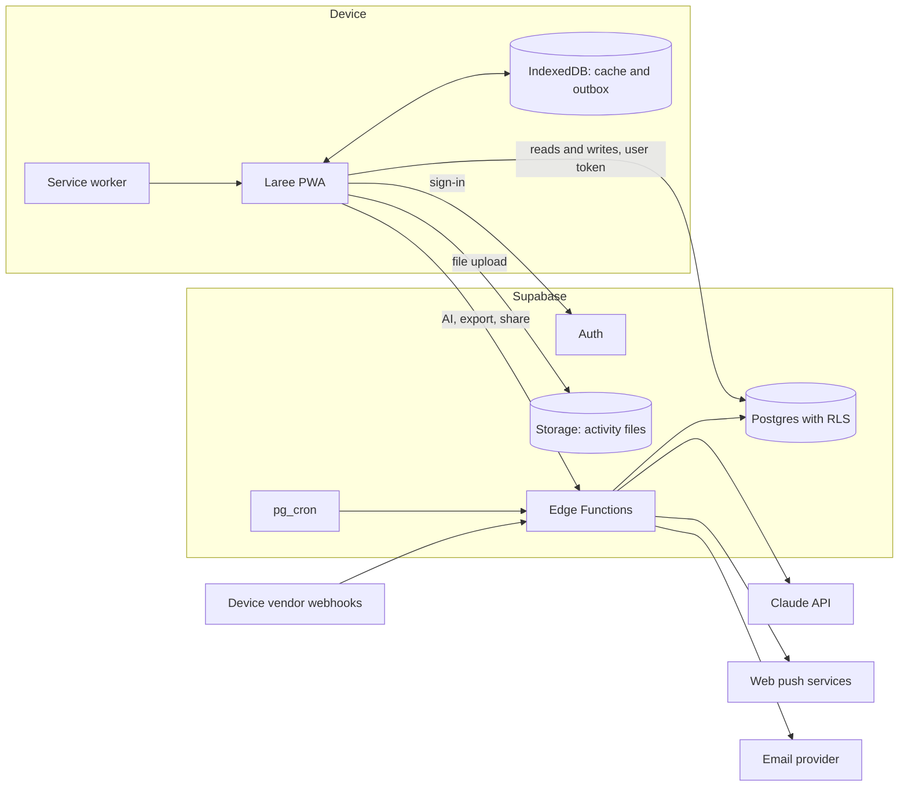

# MVP roadmap

This page plans what comes after the prototype: real accounts, real training data and a real database. It covers the phases, the Supabase architecture, a schema sketch, access rules, offline sync, the status of each device integration, notifications, AI, Malaysian data-protection law, cost, risks, decisions and what to measure in the first trial.

> **Status.** Plan only. Nothing on this page is built. The prototype (`v0.1.0-prototype`) has no backend and keeps all data on the device.
>
> **Draft marker.** Items marked [verify] are being checked against current sources and will be replaced with cited facts.

## Summary

The MVP is the same installable web app as the prototype, with two changes. Data lives in a hosted Postgres database instead of the browser, and people sign in. Everything else, including the two registers, the routes and the metric names, carries over.

| | Prototype | MVP |
|---|---|---|
| People | One device, a switcher picks who you are | Real accounts: one coach, then a few coaches, each with their own athletes |
| Data | Seeded mock data in `localStorage` (`laree:v1`) | Postgres on Supabase, with an offline copy on each device |
| Activities | Simulated device sync, file import, manual log | File upload (.FIT, .GPX, .TCX) and manual log first; device sync where a vendor grants access |
| AI | Simulated templates, labelled "Simulated AI - prototype" | Claude API called from a server function, opt-in, off by default |
| Notifications | None | Web push and email, opt-in per type |
| Hosting | GitHub Pages | Static hosting for the app, Supabase for data |

## Phases

### P0: prototype (current)

The clickable prototype on mock data, tagged `v0.1.0-prototype`. It proves the screens, the metrics engine, the flags and the exports. It ends when the coach has walked through the demo script and signed off the design.

### P1: private beta, one coach and three athletes

**Who.** The product owner as coach and their three brothers as athletes.

**Length.** 12 weeks, so one full training block fits, including at least one race for each athlete.

**In scope**

- Sign-in with a magic link. Passkeys when available (see [Architecture](#architecture-on-supabase)).
- Coach invites athletes by email. Each athlete accepts and gives explicit consent before any data flows.
- Everything the prototype does, on real data: Today, Week, Progress, Me; the coach overview, athlete page, calendar, season planner, library and builder, analytics, check-ins, flags and kudos.
- File upload of .FIT, .GPX and .TCX, and the quick manual log.
- Offline check-ins and logs that sync later.
- Exports: .zwo, .mrc, .erg, .fit workout files and .ics calendar.
- Web push and email reminders.
- "Download my data" and "Delete my account".

**Out of scope**

- Device sync. File upload covers every device in P1.
- AI. The toggle stays visible but off. AI turns on only after the consent text is reviewed (see [AI](#ai)).
- Payments, teams of coaches, public sign-up.

**Exit criteria**

- 12 weeks run with no lost check-ins or activities.
- The measures in [What to measure in the trial](#what-to-measure-in-the-trial) reach their targets, or each miss has a written fix.
- No data leaked between accounts in testing or in use.
- The privacy notice, consent text and breach runbook exist in English and Malay.

### P2: small-coach beta

**Who.** Three to five outside coaches, each with up to ten athletes. That is at most about 50 athletes.

**Length.** 12 to 16 weeks.

**In scope**

- Coach sign-up by invitation code.
- Each coach sees only their own athletes. An athlete has one coach at a time.
- Onboarding: import past files in bulk, set thresholds, copy library templates.
- One or two device integrations, chosen from the [integration table](#integration-status) by which vendors grant access.
- AI recaps and plan proposals for users who opt in at both consent layers.
- Outbound "Share to Strava" for athletes who connect their own Strava account.
- A status page and an in-app feedback form.

**Out of scope**

- Payments. Pricing is decided at the end of P2, from what coaches say they would pay.
- Native apps. They come only if Apple HealthKit or Android Health Connect becomes a must-have (see [Integration status](#integration-status)).

**Exit criteria**

- At least three coaches plan with Laree every week for 8 weeks in a row.
- A lawyer has reviewed the PDPA position before any paid plan.
- Error rate and sync measures stay within the P1 targets with 10 times the users.

## Architecture on Supabase

Supabase gives Postgres, authentication, row-level access rules, server functions and file storage in one hosted service. The app stays a static PWA. It talks to Supabase directly for reads and simple writes, and to Edge Functions for anything that needs a secret.

| Part | Job in Laree |
|---|---|
| **Postgres** | All records: athletes, plans, activities, check-ins, flags, kudos, consents. Real dates, not the prototype's day offsets. |
| **Auth** | Magic-link sign-in by email. Passkeys [verify Supabase passkey status]. One account per person. Each user is a coach or an athlete. |
| **Row Level Security (RLS)** | Access rules inside the database, so a bug in the app cannot show one athlete's data to the wrong person. See [Access rules](#access-rules-rls-in-plain-words). |
| **Edge Functions** | Server code for anything that holds a secret or runs on a schedule: AI calls, push and email sending, vendor webhooks, data export, account deletion, Strava share. |
| **Storage** | The original activity files in a private bucket, one folder per athlete. Kept so a file can be re-parsed when the metrics engine improves. |
| **pg_cron** | Nightly jobs: recompute fitness, fatigue and form; run the flag rules; send digests. |

### Where the work happens

- **File parsing runs in the browser.** The prototype already parses .FIT, .GPX and .TCX with `@garmin/fitsdk` and its own readers. The app parses the file, shows the summary at once, then uploads both the summary row and the original file. The server never has to parse a file in P1.
- **Metrics run in both places.** The pure TypeScript engine in `src/domain` runs in the browser for instant feedback and in an Edge Function for the nightly recompute. One code base, one set of tests.
- **Flags are rule-based and run on the server.** The nightly job applies the fixed rule table from `docs/spec/checkins-flags.md`. AI never raises a flag.

### Hosting region

Supabase has no Malaysian region [verify]. The nearest is Singapore (`ap-southeast-1`) [verify]. Laree hosts there. This is a cross-border transfer under the PDPA; see [Malaysian data-protection law](#malaysian-data-protection-law-pdpa).

## Schema sketch

Tables and key columns only. Every table also has `created_at` and `updated_at`. Ids are UUIDs generated on the device, so a record created offline keeps the same id after it syncs.

| Table | Key columns | Notes |
|---|---|---|
| `profiles` | `id` (= auth user id), `role` (coach, athlete), `display_name`, `locale` (en-MY), `time_zone` (Asia/Kuala_Lumpur), `units` (metric), `theme` | One row per person |
| `coach_athletes` | `coach_id`, `athlete_id`, `status` (invited, active, ended), `started_at`, `ended_at` | The link that grants a coach access. One active coach per athlete. |
| `invitations` | `id`, `coach_id`, `email`, `token_hash`, `expires_at`, `accepted_at` | Coach invites an athlete |
| `consents` | `user_id`, `purpose` (health_data, coach_sharing, ai_athlete, ai_coach, cross_border, notifications), `text_version`, `granted_at`, `withdrawn_at` | Append-only. A withdrawal is a new row, never an edit. |
| `thresholds` | `athlete_id`, `kind` (ftp, threshold_pace, css, lthr, resting_hr, hrv_baseline, weight), `value`, `unit`, `effective_from`, `source` (test, manual, estimate) | History kept, for example FTP 245 W then 255 W |
| `zones` | `athlete_id`, `sport`, `basis` (power, pace, heart rate, CSS), `bounds` (json), `effective_from` | Derived from thresholds, editable by the coach |
| `races` | `id`, `athlete_id`, `name`, `date`, `priority` (A, B, C), `sport`, `distances` (json), `goal` | |
| `phases` | `id`, `athlete_id`, `kind` (base, build, peak, taper, race, recovery), `start_date`, `end_date`, `target_hours`, `target_load` | Season planner |
| `workout_templates` | `id`, `coach_id`, `sport`, `title`, `steps` (json), `est_duration_s`, `est_load`, `tags` | The coach's library |
| `planned_workouts` | `id`, `athlete_id`, `date`, `sport`, `title`, `steps` (json), `planned_duration_s`, `planned_distance_m`, `planned_load`, `is_key`, `coach_note`, `template_id` | Steps use the same shape as the prototype: warm-up, steady, interval, recovery, cool-down, repeat block |
| `activities` | `id`, `athlete_id`, `source` (file, manual, device), `provider`, `external_id`, `started_at`, `sport`, `duration_s`, `distance_m`, `ascent_m`, `avg_hr`, `avg_power_w`, `weighted_power_w`, `load`, `load_method`, `load_confidence`, `rpe`, `notes`, `planned_workout_id`, `compliance_band`, `file_path` | Unique on (`athlete_id`, `provider`, `external_id`) so a re-upload does not duplicate |
| `activity_bests` | `activity_id`, `athlete_id`, `kind` (power, pace), `duration_s`, `value` | Best efforts for the power and pace curves |
| `check_ins` | `id`, `athlete_id`, `date`, `sleep_h`, `sleep_quality`, `soreness`, `mood`, `stress`, `hrv_ms`, `resting_hr`, `ill`, `note` | Unique on (`athlete_id`, `date`) |
| `daily_metrics` | `athlete_id`, `date`, `load`, `fitness`, `fatigue`, `form`, `ramp` | Written by the nightly job |
| `flags` | `id`, `athlete_id`, `rule_id`, `opened_on`, `values` (json), `status` (open, seen, resolved, dismissed), `handled_by`, `handled_at`, `note` | Lifecycle from `docs/spec/checkins-flags.md` |
| `kudos` | `id`, `coach_id`, `athlete_id`, `activity_id` (optional), `message` | |
| `badges` | `athlete_id`, `badge_key`, `earned_on`, `activity_id` | |
| `device_connections` | `athlete_id`, `provider`, `external_user_id`, `token_ref`, `scopes`, `status`, `connected_at` | Tokens live in an encrypted secret store, never in a column the app can read |
| `push_subscriptions` | `user_id`, `endpoint`, `p256dh`, `auth`, `user_agent` | |
| `notification_prefs` | `user_id`, `kind`, `channel` (push, email), `enabled`, `quiet_from`, `quiet_to` | |
| `ai_runs` | `id`, `user_id`, `feature`, `model`, `status`, `output`, `accepted_by`, `accepted_at` | Kept 90 days, then deleted |
| `audit_log` | `actor_id`, `action`, `table_name`, `row_id`, `at` | Who read or changed what. Append-only. |

Storage bucket `activity-files` is private. Files sit at `{athlete_id}/{activity_id}.{fit|gpx|tcx}`.

## Access rules (RLS) in plain words

RLS is switched on for every table. A table without a policy returns nothing.

**Athletes see only themselves.**

- An athlete can read every row where `athlete_id` is their own id.
- An athlete can add and edit their own check-ins, activities, activity notes and session effort (RPE).
- An athlete can read their plan, races, phases, thresholds and zones, but cannot change them. Those belong to the coach.
- An athlete never sees another athlete. The team check-in grid is a coach-only view.

**Coaches see only their athletes.**

- A coach can read an athlete's rows only while an `active` row in `coach_athletes` links the two.
- A coach can write the plan for their athletes: planned workouts, races, phases, thresholds and zones.
- A coach can give kudos and change a flag's status for their athletes.
- A coach cannot write check-ins or activities on an athlete's behalf. Those are the athlete's own record.
- A coach's library templates are private to that coach.
- When a link ends, the coach loses access at once. The athlete keeps all their data.

**Everyone.**

- Each person can read and edit their own profile, settings and notification choices.
- Consent rows can be added by their owner, never edited or deleted.
- Storage follows the same rules: the file path starts with the athlete's id, and the policy checks it.
- The service key that bypasses RLS lives only in Edge Functions. It is never shipped to a browser.

**How the rules are tested.** Every policy has a database test. The key test signs in as a second coach and checks that every table returns zero rows for the first coach's athletes. The tests run in CI on every migration.

## Offline and sync

Athletes log sessions and check in at the pool, on the road and in places with poor signal. The app must accept a check-in or a log with no network and send it later without losing or duplicating it.

**What works offline**

- The app shell, fonts and icons come from the service worker cache.
- The athlete's current week, the next 14 days of plan and the last 6 weeks of activities are cached in IndexedDB.
- The coach's views need the network. The coach works at a desk, and stale data there is worse than a clear "offline" message.

**The outbox**

1. A check-in, quick log or uploaded file is saved to an IndexedDB outbox with a device-generated id.
2. The UI shows it at once, with a small "Saved on this phone. Sends when you're online." note.
3. When the network returns, the service worker sends the outbox in order. It uses the Background Sync API where the browser has it [verify support], and otherwise sends when the app opens, regains focus or fires the `online` event.
4. Writes are upserts keyed on the device-generated id, so sending twice is harmless.
5. Large files upload in chunks with resumable uploads [verify Supabase TUS support], so a dropped connection resumes instead of restarting.

**Conflicts**

- Check-ins and activities are written only by the athlete, so the latest `updated_at` wins.
- The plan is written only by the coach, so the athlete's copy is read-only and simply refreshes.
- Matching an activity to a planned workout runs on the server after sync, so a workout the coach moved while the athlete was offline still matches by date and sport.

**Storage safety.** The app asks the browser for persistent storage (`navigator.storage.persist()`) and asks athletes to install the PWA. [verify iOS storage eviction rules for installed web apps]

## Integration status

Checked on 2026-11-07. [verify every row]

| Integration | What it would give Laree | Access today | Laree plan |
|---|---|---|---|
| Garmin Connect Developer Program | Activity push from most athletes' watches; workout push to the watch | [verify reported 2026 pause on new applications] | Apply; file upload until approved |
| Strava API | Activities the athlete already syncs to Strava | Data is shown only to the athlete who owns it, so it cannot power a coach view [verify] | Outbound "Share to Strava" only, from P2 |
| Wahoo | Activities from ELEMNT computers and KICKR trainers; workout push | [verify] | [verify] |
| COROS | Activities from COROS watches; workout push | [verify] | [verify] |
| Suunto | Activities from Suunto watches | [verify] | [verify] |
| Polar AccessLink | Activities, sleep and nightly recharge from Polar watches | [verify] | [verify] |
| Zwift | Indoor rides and runs | Partner-only [verify] | File upload of the .FIT file Zwift saves |
| TrainingPeaks API | Plans and history for athletes moving from TrainingPeaks | Partner-only [verify] | Not pursued. File upload for history. |
| Apple HealthKit | Workouts, heart rate, HRV and sleep from Apple Watch and other sources | Native iOS only; needs a native wrapper [verify] | Not before P2 review |
| Android Health Connect | Workouts, heart rate and sleep on Android | Native Android only; needs a native wrapper [verify] | Not before P2 review |
| File upload (.FIT, .GPX, .TCX) | Any device that exports a file | Works now, no permission needed | The default in P1 and the fallback forever |

## Notifications

[draft]

## AI

[draft: point to docs/spec/ai.md]

## Malaysian data-protection law (PDPA)

[draft: verify the 2024 amendments]

## Rough monthly cost

[draft]

## Risks

[draft]

## Decision log

[draft]

## What to measure in the trial

[draft]

## Sources

[draft]
