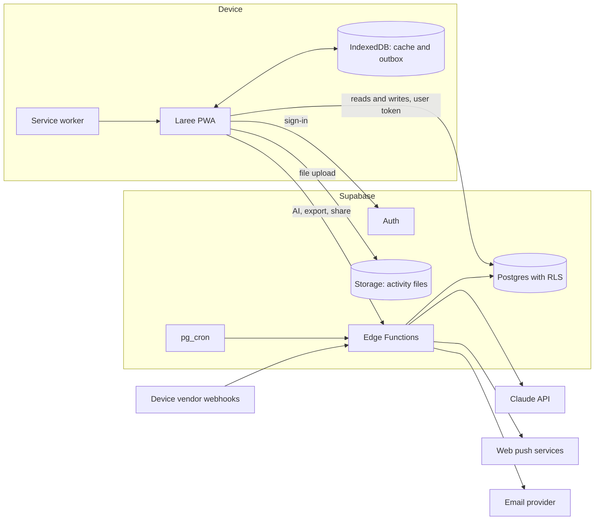

# MVP roadmap

This page plans what comes after the prototype: real accounts, real training data and a real database. It covers the phases, the Supabase architecture, a schema sketch, access rules, offline sync, the status of each device integration, notifications, AI, Malaysian data-protection law, cost, risks, decisions and what to measure in the first trial.

> **Status.** Plan only. Nothing on this page is built. The prototype (`v0.1.0-prototype`) has no backend and keeps all data on the device.
>
> **Facts checked on 2026-11-08.** Vendor, legal and price claims carry a number in square brackets that points to [Sources](#sources). Anything that could not be confirmed says "unverified".

## Summary

The MVP is the same installable web app as the prototype, with two changes. Data lives in a hosted Postgres database instead of the browser, and people sign in. Everything else, including the two registers, the routes and the metric names, carries over.

| | Prototype | MVP |
|---|---|---|
| People | One device, a switcher picks who you are | Real accounts: one coach, then a few coaches, each with their own athletes |
| Data | Seeded mock data in `localStorage` (`laree:v1`) | Postgres on Supabase, with an offline copy on each device |
| Activities | Simulated device sync, file import, manual log | File upload (.FIT, .GPX, .TCX) and manual log first; device sync where a vendor grants access |
| AI | Simulated templates, labelled "Simulated AI - prototype" | Claude API called from a server function, opt-in, off by default |
| Notifications | None | Web push and email, opt-in per type |
| Hosting | GitHub Pages | Static hosting for the app, Supabase for data |

## Phases

### P0: prototype (current)

The clickable prototype on mock data, tagged `v0.1.0-prototype`. It proves the screens, the metrics engine, the flags and the exports. It ends when the coach has walked through the demo script and signed off the design.

### P1: private beta, one coach and three athletes

**Who.** The product owner as coach and their three brothers as athletes.

**Length.** 12 weeks, so one full training block fits, including at least one race for each athlete.

**In scope**

- Sign-in with a magic link. Passkeys when available (see [Architecture](#architecture-on-supabase)).
- Coach invites athletes by email. Each athlete accepts and gives explicit consent before any data flows.
- Everything the prototype does, on real data: Today, Week, Progress, Me; the coach overview, athlete page, calendar, season planner, library and builder, analytics, check-ins, flags and kudos.
- File upload of .FIT, .GPX and .TCX, and the quick manual log.
- Offline check-ins and logs that sync later.
- Exports: .zwo, .mrc, .erg, .fit workout files and .ics calendar.
- Web push and email reminders.
- "Download my data" and "Delete my account".

**Out of scope**

- Device sync. File upload covers every device in P1.
- AI. The toggle stays visible but off. AI turns on only after the consent text is reviewed (see [AI](#ai)).
- Payments, teams of coaches, public sign-up.

**Exit criteria**

- 12 weeks run with no lost check-ins or activities.
- The measures in [What to measure in the trial](#what-to-measure-in-the-trial) reach their targets, or each miss has a written fix.
- No data leaked between accounts in testing or in use.
- The privacy notice, consent text and breach runbook exist in English and Malay.

### P2: small-coach beta

**Who.** Three to five outside coaches, each with up to ten athletes. That is at most about 50 athletes.

**Length.** 12 to 16 weeks.

**In scope**

- Coach sign-up by invitation code.
- Each coach sees only their own athletes. An athlete has one coach at a time.
- Onboarding: import past files in bulk, set thresholds, copy library templates.
- One or two device integrations, chosen from the [integration table](#integration-status) by which vendors grant access.
- AI recaps and plan proposals for users who opt in at both consent layers.
- Outbound "Share to Strava" for athletes who connect their own Strava account.
- A status page and an in-app feedback form.

**Out of scope**

- Payments. Pricing is decided at the end of P2, from what coaches say they would pay.
- Native apps. They come only if Apple HealthKit or Android Health Connect becomes a must-have (see [Integration status](#integration-status)).

**Exit criteria**

- At least three coaches plan with Laree every week for 8 weeks in a row.
- A lawyer has reviewed the PDPA position before any paid plan.
- Error rate and sync measures stay within the P1 targets with 10 times the users.

## Architecture on Supabase

Supabase gives Postgres, authentication, row-level access rules, server functions and file storage in one hosted service. The app stays a static PWA. It talks to Supabase directly for reads and simple writes, and to Edge Functions for anything that needs a secret.

| Part | Job in Laree |
|---|---|
| **Postgres** | All records: athletes, plans, activities, check-ins, flags, kudos, consents. Real dates, not the prototype's day offsets. |
| **Auth** | Magic-link sign-in by email. Supabase passkeys were still in beta on 2026-11-08 [2][3], so passkeys come once they are stable. One account per person. Each user is a coach or an athlete. |
| **Row Level Security (RLS)** | Access rules inside the database, so a bug in the app cannot show one athlete's data to the wrong person. See [Access rules](#access-rules-rls-in-plain-words). |
| **Edge Functions** | Server code for anything that holds a secret or runs on a schedule: AI calls, push and email sending, vendor webhooks, data export, account deletion, Strava share. |
| **Storage** | The original activity files in a private bucket, one folder per athlete. Kept so a file can be re-parsed when the metrics engine improves. |
| **pg_cron** | Nightly jobs: recompute fitness, fatigue and form; run the flag rules; send digests. |

### Where the work happens

- **File parsing runs in the browser.** The prototype already parses .FIT, .GPX and .TCX with `@garmin/fitsdk` and its own readers. The app parses the file, shows the summary at once, then uploads both the summary row and the original file. The server never has to parse a file in P1.
- **Metrics run in both places.** The pure TypeScript engine in `src/domain` runs in the browser for instant feedback and in an Edge Function for the nightly recompute. One code base, one set of tests.
- **Flags are rule-based and run on the server.** The nightly job applies the fixed rule table from `docs/spec/checkins-flags.md`. AI never raises a flag.

### Hosting region

Supabase has no Malaysian region. The nearest is Singapore (`ap-southeast-1`) [1]. Laree hosts there. Storing data in Singapore is a transfer abroad under the PDPA; see [Malaysian data-protection law](#malaysian-data-protection-law-pdpa).

## Schema sketch

Tables and key columns only. Every table also has `created_at` and `updated_at`. Ids are UUIDs generated on the device, so a record created offline keeps the same id after it syncs.

| Table | Key columns | Notes |
|---|---|---|
| `profiles` | `id` (= auth user id), `role` (coach, athlete), `display_name`, `locale` (en-MY), `time_zone` (Asia/Kuala_Lumpur), `units` (metric), `theme` | One row per person |
| `coach_athletes` | `coach_id`, `athlete_id`, `status` (invited, active, ended), `started_at`, `ended_at` | The link that grants a coach access. One active coach per athlete. |
| `invitations` | `id`, `coach_id`, `email`, `token_hash`, `expires_at`, `accepted_at` | Coach invites an athlete |
| `consents` | `user_id`, `purpose` (health_data, coach_sharing, ai_athlete, ai_coach, cross_border, notifications), `text_version`, `granted_at`, `withdrawn_at` | Append-only. A withdrawal is a new row, never an edit. |
| `thresholds` | `athlete_id`, `kind` (ftp, threshold_pace, css, lthr, resting_hr, hrv_baseline, weight), `value`, `unit`, `effective_from`, `source` (test, manual, estimate) | History kept, for example FTP 245 W then 255 W |
| `zones` | `athlete_id`, `sport`, `basis` (power, pace, heart rate, CSS), `bounds` (json), `effective_from` | Derived from thresholds, editable by the coach |
| `races` | `id`, `athlete_id`, `name`, `date`, `priority` (A, B, C), `sport`, `distances` (json), `goal` | |
| `phases` | `id`, `athlete_id`, `kind` (base, build, peak, taper, race, recovery), `start_date`, `end_date`, `target_hours`, `target_load` | Season planner |
| `workout_templates` | `id`, `coach_id`, `sport`, `title`, `steps` (json), `est_duration_s`, `est_load`, `tags` | The coach's library |
| `planned_workouts` | `id`, `athlete_id`, `date`, `sport`, `title`, `steps` (json), `planned_duration_s`, `planned_distance_m`, `planned_load`, `is_key`, `coach_note`, `template_id` | Steps use the same shape as the prototype: warm-up, steady, interval, recovery, cool-down, repeat block |
| `activities` | `id`, `athlete_id`, `source` (file, manual, device), `provider`, `external_id`, `started_at`, `sport`, `duration_s`, `distance_m`, `ascent_m`, `avg_hr`, `avg_power_w`, `weighted_power_w`, `load`, `load_method`, `load_confidence`, `rpe`, `notes`, `planned_workout_id`, `compliance_band`, `file_path` | Unique on (`athlete_id`, `provider`, `external_id`) so a re-upload does not duplicate |
| `activity_bests` | `activity_id`, `athlete_id`, `kind` (power, pace), `duration_s`, `value` | Best efforts for the power and pace curves |
| `check_ins` | `id`, `athlete_id`, `date`, `sleep_h`, `sleep_quality`, `soreness`, `mood`, `stress`, `hrv_ms`, `resting_hr`, `ill`, `note` | Unique on (`athlete_id`, `date`) |
| `daily_metrics` | `athlete_id`, `date`, `load`, `fitness`, `fatigue`, `form`, `ramp` | Written by the nightly job |
| `flags` | `id`, `athlete_id`, `rule_id`, `severity` (info, watch, act), `status` (open, acknowledged, resolved), `opened_on`, `last_true_on`, `values_at_open` (json), `values_latest` (json), `acknowledged_at`, `resolved_at`, `resolution` (auto, coach, no-data, week-ended), `notes` (json, coach only) | Lifecycle from `docs/spec/checkins-flags.md`. A partial unique index on (`athlete_id`, `rule_id`), where the status is open or acknowledged, keeps one live flag per rule. |
| `kudos` | `id`, `coach_id`, `athlete_id`, `activity_id` (optional), `message` | |
| `badges` | `athlete_id`, `badge_key`, `earned_on`, `activity_id` | |
| `device_connections` | `athlete_id`, `provider`, `external_user_id`, `token_ref`, `scopes`, `status`, `connected_at` | Tokens live in an encrypted secret store, never in a column the app can read |
| `push_subscriptions` | `user_id`, `endpoint`, `p256dh`, `auth`, `user_agent` | |
| `notification_prefs` | `user_id`, `kind`, `channel` (push, email), `enabled`, `quiet_from`, `quiet_to` | |
| `ai_runs` | `id`, `user_id`, `feature`, `model`, `status`, `input_tokens`, `output_tokens`, `output`, `accepted_by`, `accepted_at` | Kept 90 days, then deleted. Token counts feed the cost check. |
| `audit_log` | `actor_id`, `action`, `table_name`, `row_id`, `at` | Who read or changed what. Append-only. |

Storage bucket `activity-files` is private. Files sit at `{athlete_id}/{activity_id}.{fit|gpx|tcx}`.

## Access rules (RLS) in plain words

RLS is switched on for every table. A table without a policy returns nothing.

**Athletes see only themselves.**

- An athlete can read every row where `athlete_id` is their own id.
- An athlete can add and edit their own check-ins, activities, activity notes and session effort (RPE).
- An athlete can read their plan, races, phases, thresholds and zones, but cannot change them. Those belong to the coach.
- An athlete never sees another athlete. The team check-in grid is a coach-only view.

**Coaches see only their athletes.**

- A coach can read an athlete's rows only while an `active` row in `coach_athletes` links the two.
- A coach can write the plan for their athletes: planned workouts, races, phases, thresholds and zones.
- A coach can give kudos and change a flag's status for their athletes.
- A coach cannot write check-ins or activities on an athlete's behalf. Those are the athlete's own record.
- A coach's library templates are private to that coach.
- When a link ends, the coach loses access at once. The athlete keeps all their data.

**Everyone.**

- Each person can read and edit their own profile, settings and notification choices.
- Consent rows can be added by their owner, never edited or deleted.
- Storage follows the same rules: the file path starts with the athlete's id, and the policy checks it.
- The service key that bypasses RLS lives only in Edge Functions. It is never shipped to a browser.

**How the rules are tested.** Every policy has a database test. The key test signs in as a second coach and checks that every table returns zero rows for the first coach's athletes. The tests run in CI on every migration.

## Offline and sync

Athletes log sessions and check in at the pool, on the road and in places with poor signal. The app must accept a check-in or a log with no network and send it later without losing or duplicating it.

**What works offline**

- The app shell, fonts and icons come from the service worker cache.
- The athlete's current week, the next 14 days of plan and the last 6 weeks of activities are cached in IndexedDB.
- The coach's views need the network. The coach works at a desk, and stale data there is worse than a clear "offline" message.

**The outbox**

1. A check-in, quick log or uploaded file is saved to an IndexedDB outbox with a device-generated id.
2. The UI shows it at once, with a small "Saved on this phone. Sends when you're online." note.
3. When the network returns, the app sends the outbox in order. It sends when the app opens, regains focus or fires the `online` event. Where the browser supports the Background Sync API, the service worker also sends in the background. MDN lists that API as limited availability, because it does not work in some widely used browsers [5], so it is a bonus and never the only path.
4. Writes are upserts keyed on the device-generated id, so sending twice is harmless.
5. Large files, such as a bulk import, use Supabase's resumable (TUS) uploads, so a dropped connection resumes instead of restarting. Supabase's resumable-upload guide was not checked for this page (unverified).

**Conflicts**

- Check-ins and activities are written only by the athlete, so the latest `updated_at` wins.
- The plan is written only by the coach, so the athlete's copy is read-only and simply refreshes.
- Matching an activity to a planned workout runs on the server after sync, so a workout the coach moved while the athlete was offline still matches by date and sport.

**Storage safety.** On iPhone, WebKit may delete a site's stored data when the device runs short of space or after a period without user interaction. It grants persistent storage (`navigator.storage.persist()`) by its own rules, and one of them is whether the web app is on the Home Screen [6]. So the app asks for persistent storage, asks athletes to install the PWA, and sends the outbox at every app open, so little ever sits unsent.

## Integration status

Checked on 2026-11-08. Vendor programmes change often, so this table is checked again before P2 starts.

| Integration | What it would give Laree | Access on 2026-11-08 | Laree plan |
|---|---|---|---|
| Garmin Connect Developer Program | Activities from most athletes' watches; workouts and courses sent to the watch | Closed to new applicants from about March 2026 [9]. Reopened on 21 October 2026 with three tiers [8][10]. Personal: your own data, pulled on request, not for apps with users. Starter: push delivery only, no history, a limited number of users. Enterprise: ping or pull, at least a month of history, unlimited users, pricing set case by case. Press reports say Starter is free up to 1,000 users and Enterprise has a $1,000 entry fee with billing from 1 April 2027 (unverified). | Apply for Starter before P2. File upload until approved. See "Garmin and AI" below. |
| Strava API | Activities the athlete already syncs to Strava | The API Agreement, in force since 1 June 2026, says data from a user "can only be displayed or disclosed in your Developer Application to that user" (section 2.3) [11]. Data about other users may not be shown, even if it is public. A coach view built on Strava data would break the agreement. | Outbound "Share to Strava" only, from P2. |
| Wahoo Cloud API | Workouts and FIT files from ELEMNT computers and KICKR trainers; planned workouts sent to the device | Register an app at developers.wahooligan.com. A sandbox app works at once but is capped at 250 requests a day. Production needs Wahoo's review. Sending planned workouts to devices needs a separate entitlement from Wahoo's partnerships team. Webhooks announce each new workout [12]. | P2 candidate if an athlete rides with Wahoo. |
| COROS API | Activities from COROS watches; workouts and plans sent to the watch | For established platforms only: an existing user base, a registered company and accepted terms. Apply by form and by email. Offers workout and plan sync, FIT downloads and daily health data [13]. The page refused direct access, so this rests on search excerpts (unverified). | Not before P2. Laree does not meet the bar yet. |
| Suunto API Zone | Activities from Suunto watches as FIT files | Apply by web form and sign an agreement. A development tier comes before production [14]. In 2019 Suunto said joining its partner programme is free [15]. Current fees unverified. | P2 candidate if an athlete uses Suunto. |
| Polar AccessLink | Workouts (FIT, TCX, GPX), daily activity, sleep, Nightly Recharge, continuous heart rate and cardio load | Open to any Polar Flow user. Register a client at admin.polaraccesslink.com, then each athlete consents through OAuth 2. The page mentions no fee and no review, and documents no way to send workouts to the watch [16]. | The easiest P2 candidate, if an athlete uses Polar. |
| Zwift | Indoor rides and runs | No public developer programme found. Zwift launched a structured training API with a few partners in 2024 and said others could join later at no cost [18]. Forum threads suggest wider access has not opened [17] (unverified). | File upload of the .FIT file Zwift saves. Workouts go to Zwift as .zwo files. |
| TrainingPeaks API | Plans and history for athletes moving from TrainingPeaks | For approved commercial developers only, not for personal use [19]. | Not pursued. File upload for history. |
| Apple HealthKit | Workouts, heart rate, HRV and sleep from Apple Watch and other sources | On the device only. Apple offers no server-side HealthKit API [20], and the Capacitor health plugin does not work on the web [21]. A PWA cannot read it; it needs a native iOS app or wrapper. | Not before the P2 review (D1). |
| Android Health Connect | Workouts, heart rate and sleep on Android | On the device only. Built into Android 14 and later; older versions need the Health Connect app [20]. A PWA cannot read it; it needs a native Android app or wrapper [21]. | Not before the P2 review (D1). |
| File upload (.FIT, .GPX, .TCX) | Any device that exports a file | Works now, no permission needed | The default in P1 and the fallback forever. |

**Garmin and AI.** Open Wearables reports that Garmin's developer agreement bars sharing API data with a third party without Garmin's written permission, and bars using it to train AI models [10]. The agreement itself was not read (unverified). Laree trains no models. But sending activities that arrived through Garmin's API to the Claude API could count as sharing with a third party, so Laree asks Garmin in writing before AI runs on that data. Laree reads the rule as covering API data only, not files an athlete exports and uploads, and asks Garmin to confirm that in the same letter.

## Notifications

Notifications are opt-in, per type and per channel. Only the account emails the service needs are always on: sign-in links, invitations, "your export is ready" and account deletion. Everything else starts off, and each person turns on what they want in Settings.

| Notification | Who gets it | Channel | When | Opens |
|---|---|---|---|---|
| Morning nudge: today's session and the check-in | Athlete | Push | 07:00 local time, only if there is no check-in yet today | `#/athlete/today?sheet=check-in` |
| Plan changed | Athlete | Push | The coach adds, moves or deletes a session in the next 7 days. Changes are batched for 15 minutes, so one planning session sends one message. | `#/athlete/week` |
| Kudos | Athlete | Push | The coach gives kudos | The activity, or `#/athlete/today` |
| Weekly recap | Athlete | Email | Monday 07:00 | `#/athlete/progress` |
| Daily digest | Coach | Email | 06:00: new Act flags, missed key sessions and yesterday's missing check-ins | `#/coach/overview` |
| Act flags | Coach | Push | At most once a day, and only for flags of severity Act | `#/coach/check-ins` |
| Account and security | Everyone | Email | Sign-in links, invitations, data export ready, account deletion | None |

**Rules for every notification**

- Athletes never get a notification because of a flag. Flags are a coach tool (see [Check-ins and flags](../spec/checkins-flags.md)).
- No health values on the lock screen. A message says "Coach left kudos on your long run", never "HRV 58 ms".
- At most three pushes per person per day. Quiet hours run from 22:00 to 06:00 local time by default. A push that falls in quiet hours waits until they end, and anything over the cap goes into the next digest.
- Send times follow each person's own time zone (default Asia/Kuala_Lumpur).
- Every email has a one-click link that turns that email type off, and every push type has its own switch in Settings.

**How it works.** A pg_cron job calls an Edge Function every 15 minutes. The function picks the people whose send time has come, checks `notification_prefs` and quiet hours, and sends. Push uses the Web Push protocol with VAPID keys held as Edge Function secrets. Email goes through a transactional email provider chosen in P1, one that signs a data processing agreement.

**iPhone.** WebKit brought web push to iPhone and iPad in iOS and iPadOS 16.4, for web apps added to the Home Screen [7]. Onboarding asks athletes to install the app first, then offers push. Athletes who do not install get email only.

## AI

The AI features, their wording and the consent model are specified in [docs/spec/ai.md](../spec/ai.md). This section covers only what changes when the simulated templates become real calls.

- **Off by default, two layers.** An AI feature runs on an athlete's data only when the athlete has turned AI on for their own data and the coach has turned AI on for their side. Each switch writes a row to `consents` (`ai_athlete` or `ai_coach`) with the version of the consent text. Turning either switch off stops new runs at once.
- **Server only.** The app calls an Edge Function. The function checks both consents, builds the prompt, calls the Claude API and stores the result in `ai_runs`. The API key lives only in the function's secrets.
- **Models.** `claude-haiku-5-5` writes the weekly recap and the check-in summary. `claude-sonnet-5-5` writes the "suggest next week" change set. Each panel says that AI wrote it and names the model.
- **The coach decides.** A plan proposal is a list of changes. Nothing reaches the plan until the coach accepts it, one change at a time or all at once. Proposals, accepted or not, stay in `ai_runs` for 90 days and are then deleted.
- **Send the least data.** The prompt holds training summaries, thresholds, check-in scores and the plan. It never holds names, email addresses, GPS tracks or free-text notes. The athlete appears as "Athlete A".
- **Flags stay rule-based.** A recap may mention an open flag, but AI never opens, changes or resolves one.
- **Cross-border.** Laree treats every Claude API call as a transfer of personal data outside Malaysia, so the athlete's AI consent screen also covers that transfer (see [PDPA](#malaysian-data-protection-law-pdpa)).
- **When.** Off in P1. On in P2 for people who opt in at both layers, after a lawyer has read the consent text.

## Malaysian data-protection law (PDPA)

> **Not legal advice.** This is the product team's reading of public sources, mostly law-firm summaries, written to plan the build. The Act and the Commissioner's guidelines were not read in the original for this page. A Malaysian lawyer reviews the PDPA position before P2 opens to outside coaches, and again before any paid plan.

**Why it applies.** Malaysia's Personal Data Protection Act 2010 (Act 709, the PDPA) covers personal data processed in commercial transactions [28]. A paid Laree is clearly commercial. P1 is a free family trial, but Laree builds as if the Act applies from day one, because consent, export and deletion are cheaper to build in than to bolt on.

**Health data is sensitive.** Under the PDPA, sensitive personal data includes information about a person's physical or mental health [28]. Laree treats heart rate, HRV, sleep, soreness, mood, illness and the training record as health data, which is the cautious reading. Processing sensitive data needs the person's explicit consent (section 40; unverified against the Act text). Laree asks for that consent on its own screen, in plain words, before any data flows, and keeps each consent as a versioned, append-only row.

**The 2024 amendments.** The Personal Data Protection (Amendment) Act 2024 (Act A1727) came into force in three stages. The Minister published the dates on 24 December 2024 [22].

| In force | Change | What Laree does |
|---|---|---|
| 1 January 2025 | Minor provisions, such as serving notices electronically [22]. | Nothing extra. |
| 1 April 2025 | "Data user" becomes "data controller". Biometric data joins sensitive personal data. Data processors must follow the Security Principle themselves. The Minister's whitelist of countries for transfers abroad goes [22]. The maximum penalty for breaching the data protection principles rises from RM300,000 and 2 years in prison to RM1,000,000 and 3 years [23]. | Uses the new terms in the privacy notice. Signs data processing agreements with Supabase, the email provider and Anthropic. |
| 1 June 2025 | Controllers and processors over the guideline's thresholds must appoint a data protection officer (DPO). Controllers must report personal data breaches. People gain a right to data portability [22][25]. | See the duties below. |

**Duties that shape the build**

| Duty | What the law or guideline says | What Laree builds |
|---|---|---|
| Breach notification | The Commissioner's guideline of 25 February 2025 says: tell the Commissioner within 72 hours of becoming aware of a breach that causes or is likely to cause significant harm, then tell the people affected within 7 days of that notice. A breach of sensitive personal data counts as significant harm, and so does one that affects more than 1,000 people. Keep a register of breaches for 2 years [24][25]. | Nearly everything Laree holds is health data, so Laree plans for every breach to need both notices. A breach runbook in English and Malay, notice templates, a named person on call, a breach register, and the `audit_log` to work out who saw what. |
| Data protection officer | Needed where a controller or processor handles the personal data of more than 20,000 people, the sensitive data of more than 10,000, or carries out regular and systematic monitoring. The guideline also sets residence and language rules (Malay and English). The Commissioner must be told of an appointment within 21 days [24]. | P1 and P2 are far below the head counts. Whether daily check-ins count as regular and systematic monitoring is a question for the lawyer. The product owner is the privacy contact from P1. |
| Data portability | People can ask for their data to be sent to another controller. The Commissioner has not yet set the time limit for doing so [25]. | "Download my data" gives JSON for every record plus the original activity files. |
| Access and correction | Answer a data access request within 21 days (section 31; unverified against the Act text). | The same export answers an access request at once. Athletes correct their own records in the app. |
| Notice and choice | A written notice in Malay and English (section 7(3); unverified against the Act text). | The privacy notice and consent text in both languages. This is a P1 exit criterion. |
| Retention | Keep personal data no longer than the purpose needs [28]. | Records live while the account exists and are deleted within 30 days of account deletion. `ai_runs` go after 90 days. Supabase Pro keeps daily backups for 7 days [4]. |
| Cross-border transfer | Since 1 April 2025, data may go abroad where the destination's law is substantially similar to the PDPA or protects data to an equivalent level, or where an exception applies, such as the person's consent [23]. The Commissioner's guideline of 29 April 2025 asks for a transfer impact assessment on the first route, and for records of transfers [26][27]. | Supabase in Singapore, plus the Claude API and the email provider outside Malaysia, all named on the consent screen and in a transfer register. Laree asks for `cross_border` consent and writes a short transfer impact assessment for each destination. |
| Registration | Data users in listed classes must register with the Commissioner. Health is one of the classes [28]. | Question 3 for the lawyer. |

**Questions for the lawyer**

1. When an outside coach uses Laree in P2, who is the data controller: Laree, the coach, or both?
2. Do daily check-ins and flags count as "regular and systematic monitoring" under the DPO guideline, with about 50 athletes?
3. Does a training app fall into any class of data users that must register with the Commissioner, such as health?
4. Is a transfer impact assessment for each destination enough, or should Laree also rely on consent?
5. What does consent look like for an athlete under 18?
6. Do sections 7(3), 31 and 40 of the Act say what this page assumes?

## Rough monthly cost

List prices in US dollars, checked on 2026-11-08 [4][29]. P1 is 4 people. P2 is about 55: 5 coaches and 50 athletes.

| Item | P1 | P2 | Notes |
|---|---|---|---|
| Supabase | $25 (Pro plan) | $25 (Pro plan) | The Free plan has no backups and pauses a project after a week without activity, so P1 starts on Pro. Pro includes an 8 GB database, 100 GB of file storage, 100,000 monthly active users and daily backups kept for 7 days. Its spend cap is on by default [4]. |
| App hosting | $0 | $0 | GitHub Pages now. Any static host later. |
| Email | $0 | $0 to $20 | A provider's free tier should cover P1 (unverified; the provider is chosen in P1). |
| Web push | $0 | $0 | Browser push services are not expected to charge senders (unverified). |
| Domain | About $2 | About $2 | About $20 a year (unverified). |
| Claude API | $0 (AI off) | About $12 | See the estimate below. |
| **Total** | **About $27** | **About $40 to $60** | Plus tax and exchange-rate costs. |

**File storage.** Assume 0.3 MB per activity file and 8 sessions per athlete per week. P1 then stores about 90 MB in 12 weeks. P2 stores about 120 MB a week, or about 6 GB a year, well inside Pro's 100 GB [4].

**AI.** Per athlete per week, assume one recap and one check-in summary on `claude-haiku-5-5`, about 5,000 tokens in and 2,100 out together, and one plan proposal on `claude-sonnet-5-5`, about 8,000 tokens in and 4,000 out. The output figures allow for the models' thinking, counted at the output price. Fifty athletes make about 215 of each a month. Haiku 5.5 costs $0.10 per million input tokens and $0.50 per million output tokens for prompts up to 100,000 tokens. Sonnet 5.5 costs $2 and $10 [29]. That comes to about $0.33 a month for Haiku and about $12 for Sonnet: about $12.40 in all, or 25 cents per athlete. The token counts are guesses. After two weeks of P2, the counts stored in `ai_runs` replace them.

## Risks

| Risk | Effect | Mitigation |
|---|---|---|
| Garmin, COROS or Suunto do not grant API access, or Garmin's fees are too high | Athletes upload files by hand, which some will stop doing | File upload stays first-class. The upload sheet explains where each watch app keeps its export. Integrations are a bonus, not a dependency. |
| Garmin's agreement forbids passing its API data to the Claude API | AI features cannot use activities that came through Garmin's API | Ask Garmin in writing first (see [Garmin and AI](#integration-status)). Until Garmin agrees, AI prompts leave those activities out. |
| Strava changes its terms again | Outbound sharing breaks | Strava is outbound only, so no coach view depends on it. |
| A row-level access bug shows one athlete's data to another coach | Breach of sensitive health data | Policy tests in CI, the second-coach test, the audit log and the breach runbook. |
| The offline outbox loses or duplicates a log | Athletes stop trusting the app | Device-generated ids, upserts, an outbox the athlete can see, and a test that replays the outbox twice. |
| iOS clears a web app's storage, or push needs the app installed | Lost unsent logs, missed nudges | Ask for persistent storage, ask athletes to install, send the outbox at every app open, email as the fallback. |
| AI suggests unsafe training | Injury or illness | The coach accepts every change. Proposals cannot raise ramp above 8 a week. AI is off until both layers opt in. |
| The PDPA is misread | Fines, loss of trust | A lawyer's review before P2 and before any paid plan. Minimal data, explicit consent, export and deletion from P1. |
| Costs grow faster than users | The trial ends early | A spend cap and billing alerts on every paid service. AI calls only on demand or once a week. |
| One person builds and runs everything | Outages and slow fixes | Runbooks in the repo, managed services only, and a status page in P2. |
| Lock-in to Supabase | A costly move later | Plain Postgres, SQL migrations in the repo, and Edge Functions kept thin. |

## Decision log

"Locked" decisions come from the product owner's Q&A and are not reopened here. "Proposed" decisions are made on this page and can be changed in review.

| # | Decision | Status | Why | Revisit when |
|---|---|---|---|---|
| D1 | One installable PWA with two layouts. No native apps in P1 or P2. | Locked | One code base for four users. | HealthKit or Health Connect becomes a must-have. |
| D2 | Coaches never see Strava data. Strava is outbound sharing only. | Locked | Strava's API Agreement lets an app show a user's data only to that user [11]. | Strava's terms change. |
| D3 | File upload and quick log first. Device sync only where a vendor grants access. | Locked | Works for every device today. Garmin took no new applicants for most of 2026 [9][10]. | A vendor approves Laree. |
| D4 | AI is opt-in at two layers, off by default, server-side only. Haiku for summaries, Sonnet for plan proposals. | Locked | Health data and trust. | Model names change. |
| D5 | Flags are rule-based. AI never raises one. | Locked | A coach must be able to check every flag by hand. | Never. |
| D6 | Supabase for Postgres, auth, storage and server functions. | Proposed | One hosted service with row-level security, run by one person. | Cost or region needs change. |
| D7 | Host in Singapore. | Proposed | Supabase has no Malaysian region, and Singapore is the nearest [1]. | Supabase opens a Malaysian region. |
| D8 | Device-generated UUIDs, an IndexedDB outbox and upserts. | Proposed | Logs made offline sync once, with no duplicates. | Never expected. |
| D9 | Files are parsed in the browser. The original file is kept in storage. | Proposed | No server parsing in P1, and files can be re-parsed later. | Bulk import in P2 needs a server parser. |
| D10 | A coach cannot write check-ins or activities for an athlete. | Proposed | The athlete owns their record. | The trial shows coaches need it. |
| D11 | The UI never uses TrainingPeaks trademarks. | Locked | Trademark risk. | Never. |
| D12 | P1 runs on the Supabase Pro plan, not Free. | Proposed | The Free plan has no backups and pauses after a week without activity [4]. P1 must lose no data. | Never expected. |
| D13 | Apply for Garmin's Starter tier before P2, and ask Garmin in writing before AI runs on data from its API. | Proposed | Garmin reopened on 21 October 2026, and its agreement reportedly bars passing data to third parties [10]. | Garmin replies or changes its terms. |
| D14 | At most three pushes per person a day, and quiet hours from 22:00 to 06:00 by default. | Proposed | Nudges should help, not nag. | Opt-outs in the trial run high. |
| D15 | AI prompts carry no names, email addresses, GPS tracks or free-text notes. The athlete appears as "Athlete A". | Proposed | Send the least health data abroad. | A feature needs more, after a privacy review. |

## What to measure in the trial

The prototype trial times tasks with a stopwatch (see the [design brief](../brief/design-brief.md#success-criteria)). P1 runs on real data for 12 weeks, so it measures use and reliability instead. The app records these counts in its own tables. It sends nothing to a third-party analytics service.

| Measure | How it is counted | P1 target |
|---|---|---|
| Check-in rate | Days with a check-in divided by days in the trial, per athlete | 80% or more |
| Sessions recorded | Completed sessions that appear in Laree within 24 hours, from the coach's weekly review | 95% or more |
| Time to log | From opening the log sheet to saved, median | Under 20 s |
| Time to check in | From opening the check-in sheet to saved, median | Under 15 s |
| Coach planning time | Minutes per athlete per week, timed by the coach | Under 15 minutes |
| Act flag response | Hours from an Act flag opening to acknowledged or resolved | 90% within 24 hours |
| Sync reliability | Outbox items that reach the server exactly once | 100%, no losses, no duplicates |
| Sync delay | From back online to saved on the server, 95th percentile | Under 60 s |
| Errors | App sessions with an uncaught error | Under 1% |
| Access tests | Rows a second coach can read from the first coach's athletes | 0 |
| Weekly use | Athletes who open the app on 5 or more days a week | 3 of 3 |
| Notification opt-outs | Pushes turned off after being turned on | Watched, no target |
| Satisfaction | A five-question survey at weeks 4, 8 and 12 | Read for themes, no target |

## Sources

Numbers in square brackets in the text point to this list. "Search excerpt only" means the claim rests on a search engine's excerpt of the page, because the page itself was not opened or refused access. The law-firm articles are secondary sources: the Act and the Commissioner's guidelines were not read in the original.

**Platform and browsers**

1. Supabase Docs, "Available regions". https://supabase.com/docs/guides/platform/regions, accessed 2026-11-08. Search excerpt only.
2. Supabase Docs, "Passkey authentication". https://supabase.com/docs/guides/auth/passkeys, accessed 2026-11-08. Search excerpt only.
3. Supabase Changelog, "Passkeys for Supabase Auth (Beta)", 28 May 2026. https://supabase.com/changelog/46458-passkeys-for-supabase-auth-beta, accessed 2026-11-08. Search excerpt only.
4. Supabase, "Pricing". https://supabase.com/pricing, accessed 2026-11-08.
5. MDN Web Docs, "Background Synchronization API". https://developer.mozilla.org/en-US/docs/Web/API/Background_Synchronization_API, accessed 2026-11-08.
6. WebKit blog, "Updates to Storage Policy", 10 August 2023. https://webkit.org/blog/14403/updates-to-storage-policy/, accessed 2026-11-08.
7. WebKit blog, "Web Push for Web Apps on iOS and iPadOS", 16 February 2023. https://webkit.org/blog/13878/web-push-for-web-apps-on-ios-and-ipados/, accessed 2026-11-08.

**Device integrations**

8. Garmin Developers, "Garmin Connect Developer Program: Overview". https://developer.garmin.com/gc-developer-program/overview/, accessed 2026-11-08.
9. the5krunner, "Garmin Freezes Developer API Months After Strava Lawsuit", 14 September 2026. https://the5krunner.com/2026/09/14/garmin-developer-api-access-paused/, accessed 2026-11-08. Search excerpt only.
10. Open Wearables, "Garmin Connect Developer Program reopened: what changes for your integration", 23 October 2026. https://openwearables.io/blog/garmin-connect-developer-program-reopened, accessed 2026-11-08.
11. Strava, "API Agreement", effective 1 June 2026. https://www.strava.com/legal/api, accessed 2026-11-08.
12. Wahoo Fitness, "Wahoo Fitness API Reference". https://cloud-api.wahooligan.com/, accessed 2026-11-08.
13. COROS Support, "Submit an API Application". https://support.coros.com/hc/en-us/articles/17085887816340-Submit-an-API-Application, accessed 2026-11-08. Search excerpt only; the page refused direct access.
14. Suunto, "Suunto API Zone". https://apizone.suunto.com/, accessed 2026-11-08. Search excerpt only.
15. Suunto, "Suunto welcomes companies to join its partner program, a digital ecosystem for sports and active life", 2019. https://www.suunto.com/News/suunto-welcomes-companies-to-join-its-partner-program-a-digital-ecosystem-for-sports-and-active-life/, accessed 2026-11-08. Search excerpt only.
16. Polar, "Polar AccessLink API v3". https://www.polar.com/accesslink-api/, accessed 2026-11-08.
17. Zwift Forums, "Request to release Zwift semi-public API". https://forums.zwift.com/t/request-to-release-zwift-semi-public-api/575162, accessed 2026-11-08. Search excerpt only.
18. DC Rainmaker, "Zwift's New Structured Training API Could Be Interesting", 30 April 2024. https://dcrainmaker.com/2024/04/structured-training-interesting.html, accessed 2026-11-08.
19. TrainingPeaks Help Center, "TrainingPeaks API". https://help.trainingpeaks.com/hc/en-us/articles/234441128-TrainingPeaks-API, accessed 2026-11-08. Search excerpt only.
20. Sahha, "Apple HealthKit vs Google Health Connect: What Developers Need to Know", 12 February 2026. https://www.sahha.ai/blog/healthkit-vs-health-connect/, accessed 2026-11-08.
21. Capacitor Documentation, "Health Fitness Capacitor Plugin API". https://capacitorjs.com/docs/apis/health-fitness, accessed 2026-11-08.

**Malaysian law**

22. Rajah & Tann Asia, "News Alert: Dates of Coming into Operation of the Personal Data Protection (Amendment) Act 2024", 27 December 2024. https://www.rajahtannasia.com/?p=161886, accessed 2026-11-08.
23. Christopher & Lee Ong, "The Personal Data Protection (Amendment) Bill 2024: An Analysis and Upcoming Developments", 25 September 2024. https://www.christopherleeong.com/viewpoints/the-personal-data-protection-amendment-bill-2024-an-analysis-and-upcoming-developments/, accessed 2026-11-08.
24. DLA Piper, Privacy Matters, "Malaysia: Guidelines issued on data breach notification and data protection officer appointment", 4 March 2025. https://privacymatters.dlapiper.com/2025/03/malaysia-guidelines-issued-on-data-breach-notification-and-data-protection-officer-appointment/, accessed 2026-11-08.
25. Halim Hong & Quek, "Full implementation of the Personal Data Protection (Amendment) Act 2024: final roundup", 28 May 2025. https://hhq.com.my/posts/full-implementation-of-the-personal-data-protection-amendment-act-2024-final-roundup/, accessed 2026-11-08.
26. Mayer Brown, "From Legislative Reform to Practical Guidance: Key Amendments to Malaysia's PDPA and the Launch of Cross-Border Transfer Guidelines", 25 July 2025. https://www.mayerbrown.com/en/insights/publications/2025/07/from-legislative-reform-to-practical-guidance-key-amendments-to-malaysias-pdpa-and-the-launch-of-cross-border-transfer-guidelines, accessed 2026-11-08.
27. Skrine, "Cross Border Personal Data Transfer Guidelines Launched", April 2025. https://www.skrine.com/insights/alerts/april-2025/cross-border-personal-data-transfer-guidelines-lau, accessed 2026-11-08. Search excerpt only.
28. DLA Piper, "Data Protection Laws of the World: Malaysia". https://www.dlapiperdataprotection.com/index.html?t=law&c=MY, accessed 2026-11-08.

**AI**

29. Anthropic, "Pricing", Claude Platform documentation. https://platform.claude.com/docs/en/about-claude/pricing, accessed 2026-11-08.
